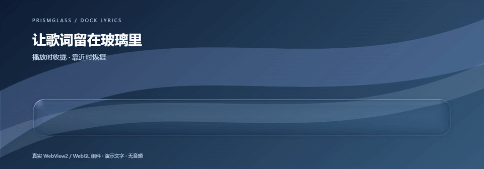
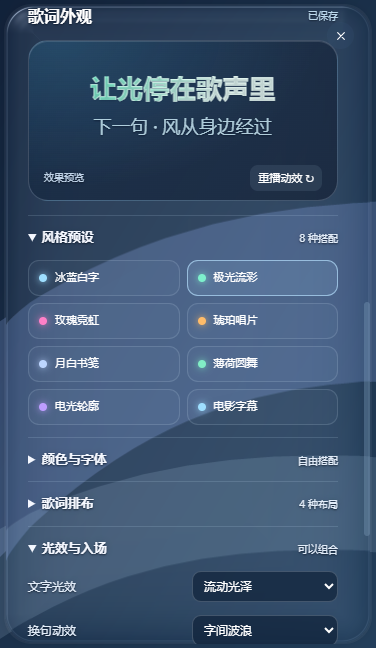
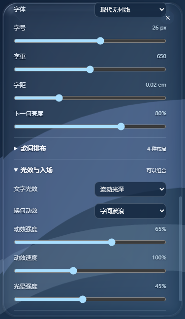
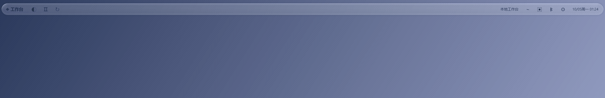
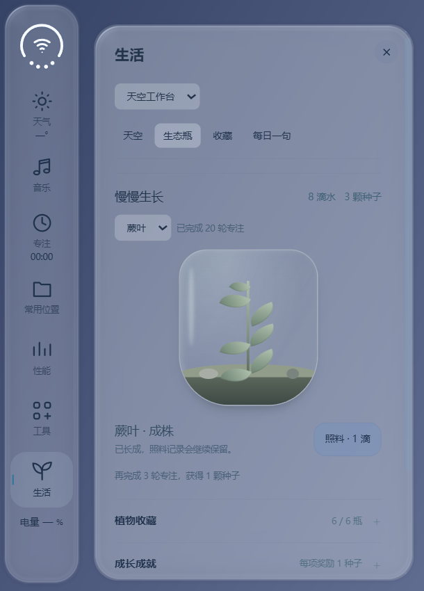
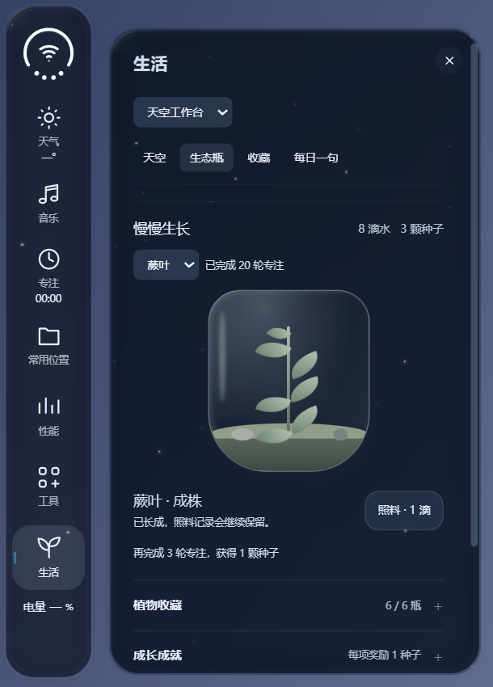
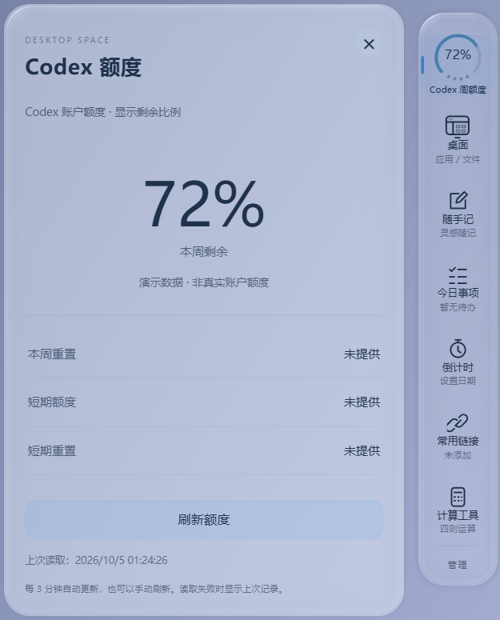
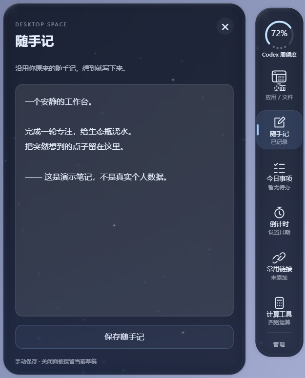
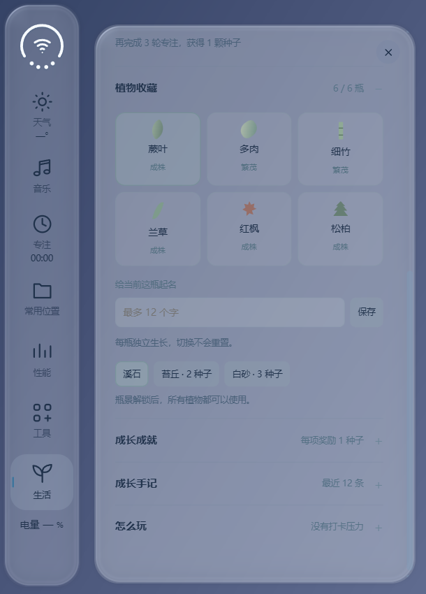
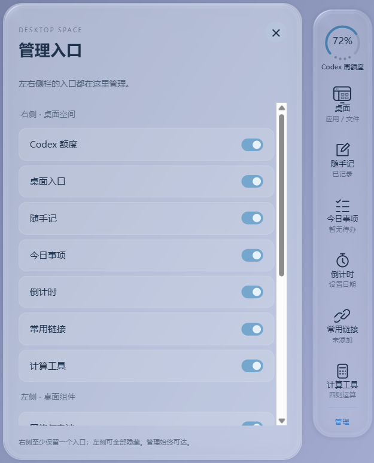

# PrismGlass Desktop

Windows 液态玻璃桌面：灵动岛式顶部栏、双侧组件、应用 Dock，以及可成长的生态瓶。

[](https://github.com/liburce0412-alt/prismglass-desktop/actions/workflows/build.yml)
[](LICENSE)


**实验性项目 / Windows x64。** 从个人长期使用的桌面方案整理而来，使用 C# WinForms + WebView2 + WebGL + Rainmeter。默认开机进入普通 Windows 桌面，美化由用户手动开启。

[看显示效果](#显示效果) · [歌词效果](#dock-歌词效果) · [功能](#功能) · [构建与安装](#构建与安装) · [操作速查](#操作速查) · [常见问题](#常见问题)

## 显示效果

以下均由本仓库的 **真实 WebView2 / WebGL 组件运行后采集**，不是设计概念图。采集使用独立预览环境、合成渐变底图与演示数据；不代表作者的真实账户额度或个人记录，也不是整台桌面的实机录屏。

### Dock 歌词效果



播放时玻璃条平滑收拢，换句时应用所选字效；鼠标靠近后恢复 Dock。动图依次展示 **冰蓝白字 / 浮起 → 极光流彩 / 波浪 → 玫瑰霓虹 / 弹性 → 月白楷体 / 聚焦**。

[查看高清 MP4](docs/media/dock-lyrics.mp4) · [素材与复现说明](docs/media/README.md#歌词效果素材)

> 约 13 秒循环，无音轨；文字均为演示句子。采集运行的是当前歌词与玻璃代码，只展示 WebView 图层，未包含 Rainmeter 应用图标。录制帧率不代表桌面实际帧率。

#### 在音乐面板里调整效果

<table>
  <tr><th>风格预设与实时预览</th><th>字体、字号与动效调节</th></tr>
  <tr>
    <td></td>
    <td></td>
  </tr>
</table>

打开 **音乐 → 歌词外观**：8 套预设、8 类字体、4 种排布、12 种换句动效和 5 种文字光效可以自由组合；颜色、强度、速度及宽度调整会自动保存。

<details>
<summary><strong>展开查看四种歌词风格的静态细节</strong></summary>

<table>
  <tr><th>冰蓝白字</th><th>极光流彩</th></tr>
  <tr>
    <td></td>
    <td></td>
  </tr>
  <tr><th>玫瑰霓虹</th><th>月白书笺</th></tr>
  <tr>
    <td></td>
    <td></td>
  </tr>
</table>

</details>

### 顶部栏 → 灵动岛 → 展开面板



点击顶部中间区域收拢，再次点击还原；按住灵动岛向下拉，展开媒体和专注控制。上面的循环演示触发同一套真实动画状态，展示形状变化；不是鼠标手势教学录屏。

[查看 MP4 演示](docs/media/top-island.mp4) · [查看展开面板原图](docs/media/top-expanded.png)

### Sky / Astro：同一套组件，两种氛围

<table>
  <tr><th>Sky · 轻透玻璃</th><th>Astro · 深色星空</th></tr>
  <tr>
    <td></td>
    <td></td>
  </tr>
</table>

两种主题保留同样的布局与操作。生态瓶会随着专注与照料成长，图中植物、滴水和种子数量均为演示存档。

### 右侧工具区：额度看板与随手记

<table>
  <tr><th>额度圆环与详情</th><th>随手记 · Astro</th></tr>
  <tr>
    <td></td>
    <td></td>
  </tr>
</table>

额度默认每三分钟更新；不可用时显示未获取。右侧同时提供桌面快捷方式、今日事项、倒计时、常用链接和计算工具，悬停查看、点击操作。

<details>
<summary><strong>更多截图：植物收藏与两侧组件管理</strong></summary>

<table>
  <tr><th>六种植物收藏</th><th>统一管理两侧入口</th></tr>
  <tr>
    <td></td>
    <td></td>
  </tr>
</table>

</details>

素材来源、演示条件与复现方法见 [效果素材说明](docs/media/README.md)。

## 功能

- **液态顶部栏**：点击中间向内聚拢，再次点击展开；按住下拉打开内容；轮廓绘制与原生裁切共用形状数据。
- **双主题**：Sky 与 Astro，保留玻璃折射、跟手渐变、形变和动态氛围。
- **左侧栏**：Wi-Fi / 电量、天气、音乐、专注、常用位置、性能、工具和生活。
- **右侧栏**：Codex 额度圆环、桌面快捷方式、随手记、今日事项、倒计时、常用链接、计算工具；支持悬停展开和统一管理。
- **生态瓶**：六种植物、独立成长、浇水、装饰、收藏、成就与日志。
- **应用 Dock**：从本机提取图标，固定应用与运行窗口，遮挡隐藏、底部边缘唤出和窗口预览。
- **Dock 歌词**：播放时玻璃底板平滑收缩，超长句缓慢滚动。音乐面板内提供 8 套预设、8 类系统字体、4 种排布、12 种换句动效、5 种文字光效，以及颜色、字号、字重、字距、亮度、光晕、动效强度/速度和宽度调整。默认白字；设置实时预览并自动保存。鼠标靠近、暂停、无歌词或媒体信息过期时恢复图标。
- **系统托盘入口**：顶部右侧箭头打开 Windows 隐藏图标托盘；关闭后恢复美化桌面，不改变任务栏的持久设置。
- **透光玻璃**：共享渲染器增加圆弧边缘厚度、RGB 折射与 Fresnel 反射，降低表面白色叠层；文字统一使用白色与轻微阴影。Dock 保留原有强度的跟手折射、彩色流光、形变与图标弹跳。
- **按需开启**：开机不运行美化或恢复脚本；手动开启后临时隐藏原生图标和任务栏，退出时恢复。

任何仍可见的最大化或全屏应用覆盖主屏时，顶部和左右栏隐藏；即使切到另一个普通窗口也保持隐藏。覆盖窗口最小化、关闭或还原为不覆盖主屏的普通窗口后恢复；已隐藏和其他虚拟桌面的窗口不参与判断。底部 Dock 保留独立的边缘唤出规则。当前以主显示器为目标。

## 操作速查

| 想做什么 | 操作 |
|---|---|
| 收起顶部栏 | 点击顶部中间留白，聚拢为灵动岛 |
| 展开顶部内容 | 按住灵动岛向下拖动 |
| 恢复完整顶部栏 | 再次点击灵动岛 |
| 打开系统托盘 | 点击顶部右侧“打开系统托盘”箭头 |
| 看侧栏内容 | 鼠标短暂停留，避免快速划过误触发 |
| 调整两侧入口 | 右侧底部进入“管理” |
| 培养生态瓶 | 左侧“生活 → 生态瓶”，完成专注获得照料资源 |
| 唤出被遮挡的 Dock | 在屏幕底边短暂停留 |
| 开启 Dock 歌词 | 左侧“音乐”中开启“让歌词留在 Dock”；需要新歌词时另开启“在线匹配” |
| 调整歌词外观 | 同一面板向下滚动到“歌词外观”，选择预设或展开颜色、字体、排布、光效设置 |
| 微调歌词时间 | 同一面板选择“提前 / 延后”，每次 0.2 秒；点中间重置 |
| 回到普通桌面 | 使用“退出 PrismGlass”快捷方式 |

## 依赖

- Windows 10/11 x64，.NET Framework 4.8。
- [PowerShell 7](https://github.com/PowerShell/PowerShell)、[Rainmeter](https://www.rainmeter.net/) 和 [WebView2 Evergreen Runtime](https://developer.microsoft.com/microsoft-edge/webview2/)。
- 开发构建需要 Node.js，用于 JavaScript 语法检查；编译使用 Windows .NET Framework 自带的 C# 编译器。
- 可选：官方 Codex CLI（自行安装并登录），用于读取本人额度。读取失败会显示未获取，不会伪造数字；默认每三分钟刷新。
- 可选：Python 3 与网易云音乐桥接，安装时显式启用。
- 可选 Dock 歌词：优先读取 Windows SMTC 歌曲信息和有效进度；另适配网易云 Windows **3.1.41.205529** 的本地播放时钟。SMTC 读取器使用系统自带 Windows PowerShell 5.1 的 .NET Framework WinRT 投影（兼容性需要）；其余脚本仍使用 PowerShell 7。歌词功能本身不依赖 Python。

## 构建与安装

在 PowerShell 7 中：

```powershell
git clone https://github.com/liburce0412-alt/prismglass-desktop.git
cd prismglass-desktop
./scripts/Test.ps1
./scripts/Build.ps1
./dist/PrismGlass/Install.ps1 -Latitude 31.23 -Longitude 121.47
```

构建会从 NuGet 下载固定版本 WebView2 SDK，不从开发者机器拷贝运行环境。安装器默认写入 `%LOCALAPPDATA%\PrismGlass`，Rainmeter 皮肤写入“文档\Rainmeter\Skins\PrismGlass”。已存在安装或同名皮肤时会停止，避免覆盖个人设置；目前没有自动迁移／覆盖升级器。

Rainmeter 在非标准目录时传入 `-RainmeterPath '你的路径\Rainmeter.exe'`。天气坐标是参数，默认是伦敦示例位置；请按需要设置。选择 `-EnableMusicBridge` 才会启用网易云音乐信息读取。要仅准备文件、不改桌面和启动项，传 `-PrepareOnly -Destination '一个新的空目录'`。

安装后使用桌面快捷方式“开启 PrismGlass”和“退出 PrismGlass”。安装器不创建登录启动项或计划任务，不会立即开启美化，也不会修改壁纸。开机保持普通桌面，美化由用户手动开启；运行期间不把任务栏自动隐藏或桌面图标隐藏保存为下次登录的设置。

当前版本使用默认“文档\Rainmeter\Skins”目录；自定义 Rainmeter SkinPath 的用户需要自行适配。不要同时运行另一套 PrismGlass 实例。

## 配置与退出

### Dock 歌词

显示和在线匹配默认均关闭，在左侧“音乐”中独立开启。开启显示后，通过 Windows 媒体会话读取当前播放的标题、歌手、专辑、时长、位置与播放状态。优先当前会话；当前暂停时选择仍在播放的会话。播放器未提供有效时间轴时保留正常 Dock，不估算歌词时间。

网易云 3.1.41.205529 未提供 SMTC 时，使用本机窗口标题、播放队列和经过版本/模块大小校验的只读播放时钟。只读取进度与时长两个数值；未验证的版本不使用该适配，仍可通过 SMTC 接入。升级网易云后若歌词停止，请先检查其媒体会话是否提供进度。

在线匹配先尝试网易云本地队列中的精确歌曲 ID（只在媒体来源为网易云时），否则通过 LRCLIB 按歌曲元数据精确匹配。不匹配纯文本歌词，不根据标题随意选相似歌曲。歌词在本地保存有大小限制的最近 32 首缓存；关闭在线匹配后仍可使用已缓存的同步歌词。切歌取消旧请求，网络失败有限次重试；无歌词时图标保持可用。

鼠标进入 Dock 附近或窗口预览时恢复图标，离开并稳定约 0.7 秒后再显示歌词。暂停、遮挡、全屏和过期媒体状态会恢复图标。已有同步歌词的前奏、空白间奏默认保留歌词栏，显示曲名及前奏/间奏标识；可关闭“前奏、间奏保持歌词栏”。短暂的文件读取冲突沿用尚未过期的采样，网易云连续约 1.2 秒无进度才判断暂停，避免空闲时反复切换。时间微调范围 ±5 秒；暂停动效或 Windows 关闭界面动画时直接切换文本。退出主进程后媒体读取器停止，Rainmeter 在歌词心跳到期后恢复图标。

歌词通过 Unicode 消息直接交给现有 WebView2 玻璃层显示，收缩沿用顶部栏可中途反向的弹簧动画，也可在外观设置中选择固定宽度。字效参考 Folia / Mineradio 的白色字芯、柔和辉光、可调字体/配色和前后句层次，自行实现。字间波浪、涟漪等是换句装饰，只有逐行 LRC 时不会伪造逐字演唱时间。字体使用本机已安装的字体，缺失时自动回退；安装器将 Rainmeter 的 `.ini`、`.inc`、`.lua` 写为 UTF-16，避免刷新频率丢失和中文乱码。

设置位于 `LiquidDesktop/lyrics-settings.json`，缓存位于 `music-data/lyrics-cache.json`。歌词与封面服务属于第三方，可能缺少歌曲、限流或不可用。实际支持取决于播放器的 SMTC 实现，不保证所有网易云、Apple Music 或其他播放器版本都提供同步进度。

### 桌面与组件

- 在右侧“管理”中控制两侧组件；笔记、事项、生态瓶进度保存在安装目录中。
- 固定应用配置在 `LiquidDesktop/pins.json`，安装时生成“文件、记事本”两个通用入口；应用路径和图标从用户自己的电脑获取。
- 顶部刷新功能采样本机当前静态壁纸作为玻璃底图；仅在本地使用，不上传壁纸。
- 若组件异常，运行 `pwsh -File '<安装目录>\DesktopMode.ps1' -Mode Recovery` 恢复原生桌面。
- 修复旧版遗留的空白桌面时，会同步清除 Explorer 当前视图与保存布局中的“隐藏图标”标记，保留图标位置和大小；不靠开机恢复脚本。手动开启美化期间只临时隐藏当前图标窗口。
- 旧版安装可能在启动文件夹留下 `PrismGlass - Restore ordinary desktop.lnk` 或“恢复原生桌面.lnk”；更新到本版后可移除指向本套安装的该快捷方式。当前安装器不再创建它。
- 卸载前先退出美化，再备份安装目录中的个人数据，移除 PrismGlass 安装目录、对应 Rainmeter 皮肤和两个桌面快捷方式。

## 隐私与依赖边界

此仓库包含白名单源码、皮肤模板、测试、文档及使用独立演示数据采集的效果素材。**不包含**作者的账号、Cookie、WebView2 用户目录、额度缓存、个人应用列表、真实笔记、私人桌面截图、游戏图标、音乐封面或原始壁纸。

运行时的本地数据和网络请求见 [隐私说明](docs/PRIVACY.md)。第三方依赖及参考见 [第三方声明](THIRD-PARTY-NOTICES.md)。MIT 许可证适用于本仓库自有代码；第三方程序、品牌与素材不由此重新授权。

## 验证范围

Dock 歌词与玻璃增强的本地检查、复现命令和仍需实机验收的边界见 [验证记录](docs/DOCK-LYRICS-VALIDATION.md)。

自动检查覆盖 Dock 隐藏／唤出策略、普通窗口与各栏的重叠、最大化／全屏识别、跨屏排除、鼠标设置保存与旧大小兼容、JavaScript 与 PowerShell 语法；CI 在 Windows 上构建。顶部与两侧按各自实际占用区域判断遮挡：普通窗口盖住哪一栏就隐藏哪一栏，移开后恢复；全屏／最大化覆盖仍隐藏全部组件，透明悬浮层不参与判断。鼠标设置另通过独立 WebView 预览交互和原生拖尾绘制检查，这些交互检查不在 CI 中自动执行。通过编译不代表已验证所有显卡、DPI、显示器布局或真实重启。当前公开版仍需更多不同机器的实际测试。

## 常见问题

**为什么我的玻璃底色与截图不同？** 玻璃使用本机壁纸采样，主题、壁纸、DPI 和显示器都会影响观感。仓库素材使用默认渐变底图，不包含作者原始壁纸。

**没有 Codex 账号可以使用吗？** 可以，桌面主体不依赖 Codex。额度组件需要自行安装并登录官方 CLI，其他组件可独立使用。

**开机会自动开启美化吗？** 不会。登录步骤只恢复普通 Windows 桌面，美化由你手动开启。

**截图就是安装后的完整桌面吗？** 不是。截图是公开代码的真实组件预览，用演示数据展示细节；当前没有把作者的私人桌面整体录屏公开。

## 目录

```text
src/LiquidDesktop/  原生窗口、数据和 WebGL/HTML 界面
rainmeter/          Rainmeter 配置模板和 Lua 数据桥
scripts/           构建、安装、恢复与检查
tests/             行为回归测试
licenses/          第三方许可文本
```

欢迎通过 Issues 提交复现步骤、Windows 版本、DPI、显示器布局及经过脱敏的画面。

### 自定义指针与拖尾
右侧栏 → 管理 → **鼠标与拖尾**，选择后即时应用并保存：

- **指针**：圆润黑、圆润白、macOS、Windows 原样；美化指针支持 75%、100%、125%、150%、200% 大小。Windows 原样沿用系统指针和大小，并保留另行保存的美化大小。
- **拖尾**：可独立开启或关闭，选择微光粒子、星光或流线；支持四个预设颜色和自定义 `#RRGGBB` 色值。关闭后仍记住样式和颜色。
- **恢复**：退出美化时重新加载原来的 Windows 指针样式和大小；下次手动开启再应用保存的美化选择，不改写 Windows 指针设置，也不需要登录恢复任务。

拖尾穿透点击、不抢焦点，与桌面共用进程；停留后自然消散，暂停动效或退出美化时关闭。文本、链接、缩放和等待指针保留各自用途。两款圆润箭头由 `tools/CreatePrismCursor.cs` 原创绘制，其余指针来自 [antiden/macOS-cursors-for-Windows](https://github.com/antiden/macOS-cursors-for-Windows)，遵循 MIT 许可。

### Pegline 截图晾绳（可选）
可随美化开启／退出，不增加开机启动。快捷键 Ctrl+Alt+T，截图接管由用户选择。照片可沿绳左右拖动，绳形随照片大小和位置变化，松手后自然回摆；向下拉离绳子仍可拖入应用或文件夹。点 × 将原图移到回收站并移除卡片；右键“仅取下（保留文件）”可只移除卡片。[安装、操作及补丁](integrations/Pegline/README.md)。
