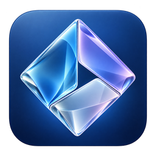
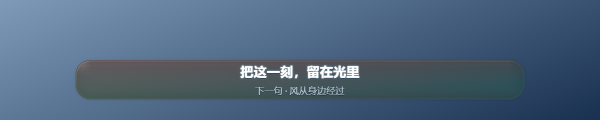

# PrismGlass Desktop



Windows 液态玻璃桌面：灵动岛式顶部栏、双侧组件、应用 Dock，以及可成长的生态瓶。

新增应用中心与统一设置：分类、单层文件夹、离线拼音搜索、Dock 拖拽整理，以及按显示器保存的组件开关和暂停策略。原有玻璃、Astro、生态瓶与歌词动效继续保留。

[](https://github.com/liburce0412-alt/prismglass-desktop/actions/workflows/build.yml)
[](LICENSE)


**实验性项目 / Windows x64。** 从个人长期使用的桌面方案整理而来，使用 C# WinForms + WebView2 + WebGL + Rainmeter。默认开机进入普通 Windows 桌面，美化由用户手动开启；可在设置中选择开机自启。

[看显示效果](#显示效果) · [歌词效果](#dock-歌词效果) · [功能](#功能) · [构建与安装](#构建与安装) · [操作速查](#操作速查) · [常见问题](#常见问题)

## 下载与安装

免费开源，MIT 许可。普通用户从 [GitHub Releases](https://github.com/liburce0412-alt/prismglass-desktop/releases) 下载 `PrismGlass-Setup-0.9.2-x64.exe`；GitHub 自动生成的 **Source code** 压缩包是开发源码，不是安装程序。本版变化见 [0.9.2 更新说明](docs/RELEASE-0.9.2.md)。

1. 运行中文安装向导，组件页自动检查 Rainmeter、WebView2 Runtime 和 .NET Framework 4.8。缺少时点击“一键补齐缺失组件”，按提示下载、校验并调用官方安装程序；失败可重试，也可选择已有程序或从官网离线安装。使用系统自带 Windows PowerShell 5.1，无需另装 PowerShell 7、Git、Node.js 或开发工具。
2. 许可页默认接受协议，默认创建一个名为 **PrismGlass** 的桌面图标，完成页默认勾选“启动 PrismGlass”。这些选择可在向导中修改；不创建开机启动项。
3. 点击“完成”后启动桌面，新安装会显示“开始使用”，可进入天气城市、歌词和显示器设置；已有用户可从统一设置重新打开引导。日后双击桌面的 **PrismGlass** 即可。退出使用托盘菜单或开始菜单的 **退出 PrismGlass**；卸载从 Windows“已安装的应用”进行。启动失败会显示原因并给出本机错误记录位置。静默安装不自动启动美化，也不自动下载依赖。

这是 **未签名的公开测试版**，面向 Windows 10/11 x64；安装器、依赖下载和其他电脑的实际兼容性尚未全面实测。不要关闭安全软件来绕过拦截。已发现问题、检查范围与反馈入口见 [验证概述](docs/VALIDATION.md)。

安装器只覆盖升级由本安装器登记的同一安装，保留用户设置；旧手工部署目录与同名未归属皮肤会安全拒绝，**不要删掉原配置来强行继续**。旧手工版本暂不自动迁移。伴随屏系统证书与网络配置不会随卸载自动删除，保留配置工具和说明供用户处理；用户数据默认保留。

在 **设置 → 天气城市** 输入城市并点击搜索，选择结果后自动保存并更新桌面及伴随屏天气，无需输入坐标或运行脚本。未选择时沿用已有坐标，新安装显示示例位置。搜索仅在主动提交时发送城市名；歌词联网和伴随屏权限仍需分别开启。组件要求重启时会提示保存工作后手动重启，不替你重启电脑。所有网络功能的条件和数据用途见 [隐私说明](docs/PRIVACY.md)。

天气搜索会同时显示完整所属地区；同名的居民点会标注“居民点”，请核对后选择。桌面天气入口统一打开本程序的天气城市设置，不再跳转到与所选坐标无关的外部地区页面。

**设置 → 启动与退出 → 开机自启** 默认关闭。开启后仅为当前 Windows 账户创建 PrismGlass 启动快捷方式，下次登录时执行完整美化启动流程；关闭会移除它。若被 Windows 禁用，设置会明确提示，并提供系统启动应用入口。退出 PrismGlass 会恢复普通桌面，不取消已经开启的自启。

## 0.9.2 更新

新增 **检查更新**：在设置页或托盘手动检查 GitHub 最新正式版本；发现新版后可打开官方发布页下载安装。匿名 API 限流时使用官方发布页的安全跳转作为后备，不需要 GitHub 登录，不自动安装。

伴随屏新增 **投屏 / 独立副屏** 两种模式。投屏仅列出主屏或其他有线物理屏；点击 **打开副屏** 才启用 iPad 虚拟屏，停止或断线超时后关闭。切换时保留实体屏原来的复制/扩展关系，并保存、恢复普通桌面图标位置。独立副屏仍需用户另行安装受支持的 Virtual Display Driver；缺少时明确显示不可用，不自动安装驱动。详见 [投屏与副屏说明](docs/COMPANION-SCREEN.md)。

视频通道跟随当前伴随屏连接地址。换 Wi-Fi 后，电脑点 **检查并连接**，iPad 再点 **开始投屏 / 打开副屏**；程序从已授权设备的真实连接读取地址，自动检查视频规则。需要修复时电脑显示新旧地址及范围，确认并通过 Windows 管理员提示后自动更新，iPad 等待后继续连接，无需手动修改 IP。已有规则正常时不弹确认；取消后可重新检查。规则仍只允许 MediaMTX、专用网卡、UDP 31890 和这一台 iPad，不扩大到整个局域网。

## 应用中心与统一设置

点击 Dock 首个应用中心图标、顶栏“工作台”，或按 **Ctrl+Alt+Space** 打开应用中心；顶栏齿轮与托盘中的 **PrismGlass 设置** 打开统一设置。Windows 设置保留为单独入口。全局快捷键可以修改，占用冲突会提示并保留原绑定。

应用中心从当前屏幕的 Dock 上方向上展开，与 Dock 保持 16 像素间距；小屏会按工作区收缩。设置中心保持居中，减少动效或暂停时不播放展开动画。

- 应用库收录用户与公共桌面、开始菜单、Shell 商店应用及手动添加的文件/文件夹。搜索支持名称、拼音、首字母、别名和多词；多音字使用第一普通话读音，可用别名补充。
- 分类、单层文件夹与排序保存为应用库元数据；移动、解散文件夹或取消固定不移动、不删除源文件。失效入口保留，可重新定位。移除收纳记录后，扫描不会自动重新加入；手动添加可以恢复。
- 拖动图标可排序、移入分类或文件夹；在另一个图标中心停留后出现新文件夹预览。Dock 内拖动显示插入位置，松手保存，Esc 取消；拖离 Dock 只取消固定。应用中心可以拖入 Dock，也可通过菜单固定。
- **Ctrl+K** 聚焦搜索，方向键选择，Enter 打开；Esc 依次取消拖拽、关闭子层、返回父层和关闭应用中心。中文输入法选字不触发打开。窗口预览可通过 Dock 菜单进入键盘选择。
- 统一设置提供外观、组件显示与排列、应用中心、Dock、歌词、快捷键、显示器、动效与省电。歌词与原音乐面板共用保存数据；恢复本页只重置该页设置。
- 多屏配置按显示器设备身份保存，副屏需要在设置中启用。组件与 Dock 分屏实例，应用索引、媒体与系统数据共用。暂停原因按集合计算，手动暂停不会被解锁、接通电源等事件自动取消。
- 美化就绪后临时隐藏主副屏的 Windows 任务栏；退出美化或组件失败时恢复，不保存 Windows 自动隐藏设置。
- Dock 距离屏幕底边默认 18 物理像素，各屏可以单独调整；隐藏任务栏后不额外保留其底部占位，不同缩放比例下间距一致。
- 桌面 Dock 与 iPad 应用入口共用窗口切换逻辑：再次点击当前前台应用时最小化该窗口；单窗口在后台或已最小化时恢复到前台，未运行时启动，多个后台窗口保留预览选择。悬停切换会清除旧名称和旧预览，歌词恢复 Dock 时保持连续过渡。

歌词背景支持 **专辑流光、跟随壁纸、透明配色、深海、松林、暖沙、夜紫**，保留原液态玻璃材质。背景颜色流动可单独开启，配色强度不降低文字透明度。专辑取色使用本机已有封面；无有效封面时回退到壁纸，不为背景配色联网下载图片。



上图使用合成配色和原创演示句。旧设置默认保持原外观；在 **歌词 → 背景配色** 中选择“专辑流光”，可单独开启颜色流动。

实现与检查边界见 [改进方案](docs/DESKTOP-IMPROVEMENTS.md) 和 [公开验证概述](docs/VALIDATION.md)。构建和隔离测试不等同于完成多屏热插拔、真实播放器和长期运行验收；其他环境通过用户实际反馈继续完善。

## QQ 音乐

QQ 音乐 Windows 版可通过系统媒体会话提供歌曲、歌手、专辑、封面和播放进度，无需额外账号或插件。开启 Dock 歌词、展开桌面音乐面板或使用已授权的伴随屏音乐时，才按需采集。本机 QQ 音乐 22.22 已读到这些信息；桌面音乐卡片可使用系统封面，播放控制会定位当前显示的媒体会话。

在线歌词仍由独立开关控制。QQ 音乐来源会先核对歌曲标题、专辑、完整歌手及播放时长，再用 QQ 歌曲详情确认唯一歌曲 ID，按该 ID 获取 QQ 提供的原曲同步歌词；官方详情中的歌手显示别名可参与核对，不随意删除 Live、Remix 或艺名括号。无法确认唯一版本时明确提示，不回退到相似歌曲。桌面与伴随屏共用这份歌词、进度与缓存。当前支持带时间戳的逐行 LRC，文字动效不代表逐字演唱时间。实际检查范围见 [验证概述](docs/VALIDATION.md)。

## iPad 网页伴随屏

电脑托盘 → **iPad 伴随屏** → **连接步骤**，按引导完成首次配置、iPad 证书信任及扫码配对；新安装不要求已有配置记录。**检查并连接** 会列出需要的系统变更，由你确认后请求管理员权限；同网卡换 IP 后重新连接即可。iPad 在 Safari 添加到主屏幕，随后从图标打开，使用窗口内的 **扫码配对** 扫电脑的配对二维码，首次仍由电脑批准。此后同一窗口记住设备，使用期间自动续期；无需每次输入码。Safari 与主屏幕的会话相互独立。伴随屏配置优先使用系统自带的 Windows PowerShell 5.1。详见[连接说明](docs/COMPANION.md#固定入口与换网)。

统一设置中的 **iPad 伴随屏** 可手动开启 HTTPS 局域网入口，供 iPad Safari 使用，包含 iPadOS 14.2 的实机检查。新版沿用 Sky/Astro 偏好，以[光学玻璃概念](docs/media/concepts/companion-optical-20261026.png)整理此刻、触控板、工作、应用、小组件和电脑视图；音乐、专注胶囊与底部 Touch Bar 共用场景，最多三个重点区域呈现光学折射，文字与操作保持清晰。最终背景按用户反馈收敛为低对比蓝灰柔光远景；概念图不是运行截图。减少动画或 WebGL 不可用时回退到静态样式。

网页提供时钟、天气、音乐歌词、专注、电脑状态、授权应用入口和可选共享的待办/笔记。Touch Bar 自动跟随 Chrome/Edge、VS Code 和音乐场景，也可一键固定当前场景；电脑控制中心集中提供音量滑条、专注、窗口切换、最大化/还原、虚拟桌面切换与电源入口。沉浸展示可选时钟与音乐、歌词舞台或安静时钟。应用每页 24 项，图标排队加载并在当前会话内复用，点击沿用桌面 Dock 的打开、激活与最小化逻辑。首页补充前两项未完成待办及日期提醒；音乐显示播放器提供的真实进度，可从卡片展开歌词舞台。本地小组件提供倒计时（1/3/5/15 分钟快捷选择）、秒表（最近五圈）、计算器、日期距离、世界时钟和呼吸节奏，加上按权限显示的天气、待办摘要和沉浸入口，共九种；可整理顺序与可见性，只保存非私人偏好。

在 **桌面与歌词** 中可保存电脑主题、玻璃浓度、字体大小、Dock、组件显隐和暂停策略；歌词同步电脑的字体风格、材质、颜色、换句动效与背景配色，字号适配 iPad。歌词外观需音乐与控制权限，有独立修订号，修改不改变原有显示/联网开关或时间偏移。显式开启会恢复本安装已有的隐藏采集，音乐元数据不依赖桌面歌词开关。两端冲突保留编辑，坏设置文件不会被默认值覆盖。

触控板支持单指移动、轻点左键、双击按住拖拽、双指轻点右键、双指滚动及灵敏度/自然滚动调整。右侧独立滚轮区支持上下滑动和单格滚动按钮。**触控板、键盘输入、屏幕画面和电源控制分别授权，默认关闭**。配置 FFmpeg NVIDIA 编码与 MediaMTX 后，可在同一 Safari 页面选择主屏或扩展屏、720p / 1080p 画面；播放后铺满页面，右上角按钮展开或收起控制面板。点击键盘调用 iPad 原生输入法，中文选词后发送到电脑当前窗口，也可使用固定常用按键。目标 30 帧，无音频，画面沿用触控板手势。离开页面、锁屏或撤销授权后停止采集；iPad Air 2 / iPadOS 14.2 短时实测 720p、1080p 均约 30 帧，全屏与中文输入已由用户实机确认，见 [投屏配置与边界](docs/COMPANION-SCREEN.md)。电脑管理窗改为蓝灰设备布局，唯一设备自动选中，权限草稿在刷新和切换设备后保留，点击 **保存设备权限** 才生效；二维码与连接配置按需展开。扫码预填配对码，提交后仍需电脑批准，无需安装 iPad App。锁定、睡眠、重启/关机分别在二次确认后等待 3、5、15 秒，倒计时内可取消；不强制关闭应用，操作不自动重放。开机 / Wake-on-LAN 尚未配置。

入口默认关闭，每次启动后需手动开启；所有共享权限默认全关，应用由电脑逐项选择。待办/笔记通过同一写入与冲突检查保存，Windows 锁屏或网页断线时隐藏私人内容并停止本页控制。首次部署需要匹配局域网地址的证书、iPad 信任设置及受限网络规则，见 [连接、操作与部署说明](docs/COMPANION.md)。源码、本机安装与真实设备结果分别说明于[验证概述](docs/VALIDATION.md)；当前 iPad 主屏幕内扫码、重开连接、真实触控/滚轮、GPU 和长期表现仍待实际使用反馈，隔离测试不会执行真实电源操作。

## 显示效果

以下均由本仓库的 **真实 WebView2 / WebGL 组件运行后采集**，不是设计概念图。采集使用独立预览环境、合成渐变底图与演示数据；不代表作者的真实账户额度或个人记录，也不是整台桌面的实机录屏。

### Dock 歌词效果


播放时玻璃条平滑收拢，换句时应用所选字效；鼠标靠近后恢复 Dock。动图依次展示 **冰蓝白字 / 浮起 → 极光流彩 / 波浪 → 玫瑰霓虹 / 弹性 → 月白楷体 / 聚焦**。

[查看高清 MP4](docs/media/dock-lyrics.mp4) · [素材与复现说明](docs/media/README.md#歌词效果素材)

> 约 13 秒循环，无音轨；文字均为演示句子。采集运行的是当前歌词与玻璃代码，只展示 WebView 图层，未包含 Rainmeter 应用图标。录制帧率不代表桌面实际帧率。

#### 在音乐面板里调整效果

<table>
  <tr><th>风格预设与实时预览</th><th>字体、字号与动效调节</th></tr>
  <tr>
    <td></td>
    <td></td>
  </tr>
</table>

打开 **音乐 → 歌词外观**：8 套预设、8 类字体、4 种排布、12 种换句动效和 5 种文字光效可以自由组合；颜色、强度、速度及宽度调整会自动保存。

<details>
<summary><strong>展开查看四种歌词风格的静态细节</strong></summary>

<table>
  <tr><th>冰蓝白字</th><th>极光流彩</th></tr>
  <tr>
    <td></td>
    <td></td>
  </tr>
  <tr><th>玫瑰霓虹</th><th>月白书笺</th></tr>
  <tr>
    <td></td>
    <td></td>
  </tr>
</table>

</details>

### 顶部栏 → 灵动岛 → 展开面板


点击顶部中间区域收拢，再次点击还原；按住灵动岛向下拉，展开媒体和专注控制。上面的循环演示触发同一套真实动画状态，展示形状变化；不是鼠标手势教学录屏。

[查看 MP4 演示](docs/media/top-island.mp4) · [查看展开面板原图](docs/media/top-expanded.png)

### Sky / Astro：同一套组件，两种氛围

<table>
  <tr><th>Sky · 轻透玻璃</th><th>Astro · 深色星空</th></tr>
  <tr>
    <td></td>
    <td></td>
  </tr>
</table>

两种主题保留同样的布局与操作。生态瓶会随着专注与照料成长，图中植物、滴水和种子数量均为演示存档。

### 右侧工具区：额度看板与随手记

<table>
  <tr><th>额度圆环与详情</th><th>随手记 · Astro</th></tr>
  <tr>
    <td></td>
    <td></td>
  </tr>
</table>

额度默认每三分钟更新；不可用时显示未获取。右侧同时提供桌面快捷方式、今日事项、倒计时、常用链接和计算工具，悬停查看、点击操作。

<details>
<summary><strong>更多截图：植物收藏与两侧组件管理</strong></summary>

<table>
  <tr><th>六种植物收藏</th><th>统一管理两侧入口</th></tr>
  <tr>
    <td></td>
    <td></td>
  </tr>
</table>

</details>

素材来源、演示条件与复现方法见 [效果素材说明](docs/media/README.md)。

## 功能

- **液态顶部栏**：点击中间向内聚拢，再次点击展开；按住下拉打开内容；轮廓绘制与原生裁切共用形状数据。
- **双主题**：Sky 与 Astro，保留玻璃折射、跟手渐变、形变和动态氛围。
- **左侧栏**：Wi-Fi / 电量、天气、音乐、专注、常用位置、性能、工具和生活。
- **右侧栏**：Codex 额度圆环、桌面快捷方式、随手记、今日事项、倒计时、常用链接、计算工具；支持悬停展开和统一管理。
- **生态瓶**：六种植物、独立成长、浇水、装饰、收藏、成就与日志。
- **应用 Dock**：从本机提取图标，固定应用与运行窗口，遮挡隐藏、底部边缘唤出和窗口预览。
- **Dock 歌词**：播放时玻璃底板平滑收缩，超长句缓慢滚动。音乐面板内提供 8 套预设、8 类系统字体、4 种排布、12 种换句动效、5 种文字光效，以及颜色、字号、字重、字距、亮度、光晕、动效强度/速度和宽度调整。默认白字；设置实时预览并自动保存。鼠标靠近、暂停、无歌词或媒体信息过期时恢复图标。
- **系统托盘入口**：顶部右侧箭头打开 Windows 隐藏图标托盘；关闭后恢复美化桌面，不改变任务栏的持久设置。
- **透光玻璃**：共享渲染器增加圆弧边缘厚度、RGB 折射与 Fresnel 反射，降低表面白色叠层；文字统一使用白色与轻微阴影。Dock 保留原有强度的跟手折射、彩色流光、形变与图标弹跳。
- **按需开启**：默认开机不运行美化或恢复脚本，可选择开机自启；美化就绪后临时隐藏原生图标和任务栏，退出时恢复。

任何仍可见的最大化或全屏应用覆盖主屏时，顶部和左右栏隐藏；即使切到另一个普通窗口也保持隐藏。覆盖窗口最小化、关闭或还原为不覆盖主屏的普通窗口后恢复；已隐藏和其他虚拟桌面的窗口不参与判断。底部 Dock 保留独立的边缘唤出规则。当前以主显示器为目标。

## 操作速查

| 想做什么 | 操作 |
|---|---|
| 收起顶部栏 | 点击顶部中间留白，聚拢为灵动岛 |
| 展开顶部内容 | 按住灵动岛向下拖动 |
| 恢复完整顶部栏 | 再次点击灵动岛 |
| 打开系统托盘 | 点击顶部右侧“打开系统托盘”箭头 |
| 看侧栏内容 | 鼠标短暂停留，避免快速划过误触发 |
| 调整两侧入口 | 右侧底部进入“管理” |
| 培养生态瓶 | 左侧“生活 → 生态瓶”，完成专注获得照料资源 |
| 唤出被遮挡的 Dock | 在屏幕底边短暂停留 |
| 开启 Dock 歌词 | 左侧“音乐”中开启“让歌词留在 Dock”；需要新歌词时另开启“在线匹配” |
| 调整歌词外观 | 同一面板向下滚动到“歌词外观”，选择预设或展开颜色、字体、排布、光效设置 |
| 微调歌词时间 | 同一面板选择“提前 / 延后”，每次 0.2 秒；点中间重置 |
| 回到普通桌面 | 使用“退出 PrismGlass”快捷方式 |

## 依赖

- Windows 10/11 x64，.NET Framework 4.8。
- Windows 自带 PowerShell 5.1、[Rainmeter](https://www.rainmeter.net/) 和 [WebView2 Evergreen Runtime](https://developer.microsoft.com/microsoft-edge/webview2/)。已有 PowerShell 7 安装仍可复用；开发构建与测试脚本使用 PowerShell 7。
- 开发构建需要 Node.js，用于 JavaScript 语法检查；编译使用 Windows .NET Framework 自带的 C# 编译器。
- 可选：官方 Codex CLI（自行安装并登录），用于读取本人额度。读取失败会显示未获取，不会伪造数字；默认每三分钟刷新。
- 可选：Python 3 与网易云音乐桥接，安装时显式启用。
- 可选 Dock 歌词：优先读取 Windows SMTC 歌曲信息和有效进度；另适配网易云 Windows **3.1.41.205529** 的本地播放时钟。SMTC 读取器使用系统自带 Windows PowerShell 5.1 的 .NET Framework WinRT 投影（兼容性需要）；安装、卸载、桌面运行和伴随屏配置均兼容 5.1；仅开发构建与测试入口使用 PowerShell 7。歌词功能本身不依赖 Python。

## 构建与安装

在 PowerShell 7 中：

```powershell
git clone https://github.com/liburce0412-alt/prismglass-desktop.git
cd prismglass-desktop
./scripts/Test.ps1
./scripts/Build.ps1
./dist/PrismGlass/Install.ps1 -Latitude 31.23 -Longitude 121.47
```

安装 Inno Setup 6 后，可生成与 Releases 同格式的安装器：

```powershell
./scripts/Package.ps1 -CompilerPath 'C:\Program Files (x86)\Inno Setup 6\ISCC.exe' -Version (Get-Content VERSION -Raw).Trim()
```

发行构建应使用干净签出与空输出目录；`-CacheRoot` 可复用开发依赖，`-OutputRoot` 可指定独立构建目录，不能指向正在使用的安装。`Package.ps1` 会拒绝个人配置、配对记录和证书文件。源码版本、程序版本与安装器版本来自 `VERSION`。

以上为开发者构建与脚本安装方式；普通用户使用 Releases 中的 EXE。构建从 NuGet 获取固定版本 WebView2 SDK 和 QRCoder，不复制开发者运行目录。脚本默认安装到 `%LOCALAPPDATA%\PrismGlass`，根据 Rainmeter 配置识别皮肤目录；旧手工安装与未归属皮肤不会自动覆盖。

Rainmeter 在非标准目录时传入 `-RainmeterPath '你的路径\Rainmeter.exe'`。天气坐标是参数，默认是伦敦示例位置；请按需要设置。选择 `-EnableMusicBridge` 才会启用网易云音乐信息读取。要仅准备文件、不改桌面和启动项，传 `-PrepareOnly -Destination '一个新的空目录'`。

图形安装后使用桌面的 **PrismGlass** 启动，退出在托盘或开始菜单中操作。图形安装向导默认在点击“完成”后开启美化，可取消该选项；开发者脚本和静默安装不自动启动。安装不创建登录启动项或计划任务，不修改系统壁纸；开机自启由用户在“启动与退出”中选择，默认关闭。直接打开程序也执行完整启动流程；运行期间不把任务栏自动隐藏或桌面图标隐藏保存为下次登录的设置。

安装时记录 Rainmeter 实际 SkinPath，运行组件共用该路径。不要同时运行另一套 PrismGlass 实例。

## 配置与退出

### Dock 歌词

显示和在线匹配默认均关闭，在左侧“音乐”中独立开启。开启显示后，通过 Windows 媒体会话读取当前播放的标题、歌手、专辑、时长、位置与播放状态。优先当前会话；当前暂停时选择仍在播放的会话。播放器未提供有效时间轴时保留正常 Dock，不估算歌词时间。

网易云 3.1.41.205529 未提供 SMTC 时，使用本机窗口标题、播放队列和经过版本/模块大小校验的只读播放时钟。只读取进度与时长两个数值；未验证的版本不使用该适配，仍可通过 SMTC 接入。升级网易云后若歌词停止，请先检查其媒体会话是否提供进度。

QQ 音乐按上方的歌曲版本确认流程获取原曲歌词；网易云来源先尝试本地队列中的精确歌曲 ID，其他来源或网易云未命中时通过 LRCLIB 按歌曲元数据精确匹配。不匹配纯文本歌词，不根据标题随意选相似歌曲。歌词在本地保存有大小限制的最近 32 首缓存；关闭在线匹配后仍可使用已缓存的同步歌词。QQ 的已验证缓存与旧匹配缓存区分，旧结果不会绕过版本确认。切歌取消旧请求，网络失败有限次重试；无歌词时图标保持可用。

鼠标进入 Dock 附近或窗口预览时恢复图标，离开并稳定约 0.7 秒后再显示歌词。暂停、遮挡、全屏和过期媒体状态会恢复图标。已有同步歌词的前奏、空白间奏默认保留歌词栏，显示曲名及前奏/间奏标识；可关闭“前奏、间奏保持歌词栏”。短暂的文件读取冲突沿用尚未过期的采样，网易云连续约 1.2 秒无进度才判断暂停，避免空闲时反复切换。时间微调范围 ±5 秒；暂停动效或 Windows 关闭界面动画时直接切换文本。退出主进程后媒体读取器停止，Rainmeter 在歌词心跳到期后恢复图标。

歌词通过 Unicode 消息直接交给现有 WebView2 玻璃层显示，收缩沿用顶部栏可中途反向的弹簧动画，也可在外观设置中选择固定宽度。字效参考 Folia / Mineradio 的白色字芯、柔和辉光、可调字体/配色和前后句层次，自行实现。字间波浪、涟漪等是换句装饰，只有逐行 LRC 时不会伪造逐字演唱时间。字体使用本机已安装的字体，缺失时自动回退；安装器将 Rainmeter 的 `.ini`、`.inc`、`.lua` 写为 UTF-16，避免刷新频率丢失和中文乱码。

设置位于 `LiquidDesktop/lyrics-settings.json`，缓存位于 `music-data/lyrics-cache.json`。歌词与封面服务属于第三方，可能缺少歌曲、限流或不可用。实际支持取决于播放器的 SMTC 实现，不保证所有网易云、Apple Music 或其他播放器版本都提供同步进度。

### 桌面与组件

- 在右侧“管理”中控制两侧组件；笔记、事项、生态瓶进度保存在安装目录中。
- 固定应用配置在 `LiquidDesktop/pins.json`，安装时生成“文件、记事本”两个通用入口；应用路径和图标从用户自己的电脑获取。
- 顶部刷新功能采样本机当前静态壁纸作为玻璃底图，显示更新进度、完成或失败提示；它不会更换 Windows 壁纸。同一张壁纸重复刷新，外观可能没有变化。采样仅在本地使用，不上传壁纸。
- 若组件异常，运行 `pwsh -File '<安装目录>\DesktopMode.ps1' -Mode Recovery` 恢复原生桌面。
- 修复旧版遗留的空白桌面时，会同步清除 Explorer 当前视图与保存布局中的“隐藏图标”标记，保留图标位置和大小；不靠开机恢复脚本。手动开启美化期间只临时隐藏当前图标窗口。
- 旧版安装可能在启动文件夹留下 `PrismGlass - Restore ordinary desktop.lnk` 或“恢复原生桌面.lnk”；更新到本版后可移除指向本套安装的该快捷方式。当前安装器不再创建它。
- 使用图形安装器安装的版本，先退出美化，再从 Windows“已安装的应用”卸载。卸载器移除所属程序、Rainmeter 皮肤代码和快捷方式，默认保留个人数据、伴随屏配置记录与共享依赖；需要保留的内容可先备份。旧脚本安装不在该卸载器的管理范围内。

## 隐私与依赖边界

此仓库包含白名单源码、皮肤模板、测试、文档及使用独立演示数据采集的效果素材。**不包含**作者的账号、Cookie、WebView2 用户目录、额度缓存、个人应用列表、真实笔记、私人桌面截图、游戏图标、音乐封面或原始壁纸。

运行时的本地数据和网络请求见 [隐私说明](docs/PRIVACY.md)。第三方依赖及参考见 [第三方声明](THIRD-PARTY-NOTICES.md)。MIT 许可证适用于本仓库自有代码；第三方程序、品牌与素材不由此重新授权。

## 验证范围

Dock 歌词与玻璃增强的本地检查、复现命令和仍需实机验收的边界见 [验证记录](docs/DOCK-LYRICS-VALIDATION.md)。

自动检查覆盖 Dock 隐藏／唤出策略、普通窗口与各栏的重叠、最大化／全屏识别、跨屏排除、鼠标设置保存与旧大小兼容、JavaScript 与 PowerShell 语法；CI 在 Windows 上构建。顶部与两侧按各自实际占用区域判断遮挡：普通窗口盖住哪一栏就隐藏哪一栏，移开后恢复；全屏／最大化覆盖仍隐藏全部组件，透明悬浮层不参与判断。鼠标设置另通过独立 WebView 预览交互和原生拖尾绘制检查，这些交互检查不在 CI 中自动执行。通过编译不代表已验证所有显卡、DPI、显示器布局或真实重启。当前公开版仍需更多不同机器的实际测试。

## 常见问题

**为什么我的玻璃底色与截图不同？** 玻璃使用本机壁纸采样，主题、壁纸、DPI 和显示器都会影响观感。仓库素材使用默认渐变底图，不包含作者原始壁纸。

**没有 Codex 账号可以使用吗？** 可以，桌面主体不依赖 Codex。额度组件需要自行安装并登录官方 CLI，其他组件可独立使用。

**开机会自动开启美化吗？** 默认不会。在 **设置 → 启动与退出** 开启“开机自启”后，下次登录当前 Windows 账户时自动开启美化；可随时关闭。

**截图就是安装后的完整桌面吗？** 不是。截图是公开代码的真实组件预览，用演示数据展示细节；当前没有把作者的私人桌面整体录屏公开。

## 目录

```text
src/LiquidDesktop/  原生窗口、数据和 WebGL/HTML 界面
rainmeter/          Rainmeter 配置模板和 Lua 数据桥
scripts/           构建、安装、恢复与检查
tests/             行为回归测试
licenses/          第三方许可文本
```

欢迎通过 Issues 提交复现步骤、Windows 版本、DPI、显示器布局及经过脱敏的画面。

### 自定义指针与拖尾
右侧栏 → 管理 → **鼠标与拖尾**，选择后即时应用并保存：

- **指针**：圆润黑、圆润白、macOS、Windows 原样；美化指针支持 75%、100%、125%、150%、200% 大小。Windows 原样沿用系统指针和大小，并保留另行保存的美化大小。
- **拖尾**：可独立开启或关闭，选择微光粒子、星光或流线；支持四个预设颜色和自定义 `#RRGGBB` 色值。关闭后仍记住样式和颜色。
- **恢复**：退出美化时重新加载原来的 Windows 指针样式和大小；下次手动开启再应用保存的美化选择，不改写 Windows 指针设置，也不需要登录恢复任务。

拖尾穿透点击、不抢焦点，与桌面共用进程；停留后自然消散，暂停动效或退出美化时关闭。文本、链接、缩放和等待指针保留各自用途。两款圆润箭头由 `tools/CreatePrismCursor.cs` 原创绘制，其余指针来自 [antiden/macOS-cursors-for-Windows](https://github.com/antiden/macOS-cursors-for-Windows)，遵循 MIT 许可。

### Pegline 截图晾绳（可选）
可随美化开启／退出，不增加开机启动。快捷键 Ctrl+Alt+T，截图接管由用户选择。照片可沿绳左右拖动，绳形随照片大小和位置变化，松手后自然回摆；向下拉离绳子仍可拖入应用或文件夹。点 × 将原图移到回收站并移除卡片；右键“仅取下（保留文件）”可只移除卡片。[安装、操作及补丁](integrations/Pegline/README.md)。
