# PrismGlass Desktop

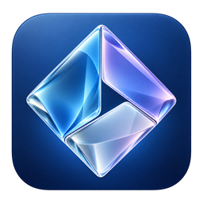

Windows 液态玻璃桌面：灵动岛式顶部栏、双侧组件、应用 Dock，以及可成长的生态瓶。

新增应用中心与统一设置：分类、单层文件夹、离线拼音搜索、Dock 拖拽整理，以及按显示器保存的组件开关和暂停策略。原有玻璃、Astro、生态瓶与歌词动效继续保留。

[](https://github.com/liburce0412-alt/prismglass-desktop/actions/workflows/build.yml)
[](LICENSE)


**2.0.1 正式版 · Windows 10/11 x64。** 使用 C# WinForms、WebView2、WebGL 和 Rainmeter。默认登录进入普通 Windows 桌面，可在设置中开启 PrismGlass 自启。

[看显示效果](#显示效果) · [歌词效果](#dock-歌词效果) · [功能](#功能) · [构建与安装](#构建与安装) · [操作速查](#操作速查) · [常见问题](#常见问题)

## 下载与安装

免费开源，采用 MIT 许可。在正式版发布页选择 `PrismGlass-Setup-2.0.1-x64.exe` 安装。发布页也提供源码和安装器 SHA-256 校验文件。手动升级前，请在 Windows 托盘关闭 iPad 伴随屏，再退出 PrismGlass 桌面。[2.0.1 发布页](https://github.com/liburce0412-alt/prismglass-desktop/releases/tag/v2.0.1) · [更新与验收范围](docs/RELEASE-2.0.1.md)

1. 运行中文安装向导，组件页自动检查 Rainmeter、WebView2 Runtime 和 .NET Framework 4.8。缺少时点击“一键补齐缺失组件”，按提示下载、校验并调用官方安装程序；失败可重试，也可选择已有程序或从官网离线安装。使用系统自带 Windows PowerShell 5.1，无需另装 PowerShell 7、Git、Node.js 或开发工具。
2. 许可页默认接受协议，默认创建一个名为 **PrismGlass** 的桌面图标，完成页默认勾选“启动 PrismGlass”。这些选择可在向导中修改；不创建开机启动项。
3. 点击“完成”后启动桌面，新安装会显示“开始使用”，可搜索“动画”“玻璃”“快捷键”等关键词并打开对应设置，也可进入天气城市、歌词和显示器设置；已有用户可从统一设置重新打开引导。日后双击桌面的 **PrismGlass** 即可。退出使用托盘菜单或开始菜单的 **退出 PrismGlass**；卸载从 Windows“已安装的应用”进行。启动失败会显示原因并给出本机错误记录位置。静默安装不自动启动美化，也不自动下载依赖。

**正式版安装包尚未数字签名**，面向 Windows 10/11 x64；安装器、依赖下载和其他电脑的实际兼容性尚未全面实测。不要关闭安全软件来绕过拦截。已发现问题、检查范围与反馈入口见 [验证概述](docs/VALIDATION.md)。

安装器只覆盖升级由本安装器登记的同一安装，保留用户设置；旧手工部署目录与同名未归属皮肤会安全拒绝，**不要删掉原配置来强行继续**。旧手工版本暂不自动迁移。伴随屏系统证书与网络配置不会随卸载自动删除，保留配置工具和说明供用户处理；用户数据默认保留。

在 **设置 → 天气城市** 输入城市并点击搜索，选择结果后自动保存并更新桌面及伴随屏天气，无需输入坐标或运行脚本。未选择时沿用已有坐标，新安装显示示例位置。搜索仅在主动提交时发送城市名；歌词联网和伴随屏权限仍需分别开启。组件要求重启时会提示保存工作后手动重启，不替你重启电脑。所有网络功能的条件和数据用途见 [隐私说明](docs/PRIVACY.md)。

天气搜索会同时显示完整所属地区；同名的居民点会标注“居民点”，请核对后选择。桌面天气入口统一打开本程序的天气城市设置，不再跳转到与所选坐标无关的外部地区页面。

天气优先采用中国气象局 CMA GRAPES 模式，经 Open-Meteo 分发；不可用时回退到 Open-Meteo 综合预报。桌面和已授权伴随屏共用温度、体感、当日高低温与更新时间，界面注明数据来源。这些是数值模式估计，并非气象站实时观测。更新失败保留并标记上次数据，超过两小时不再显示为当前天气；没有有效值时显示等待或失败状态，不填入 0℃。

天气和城市搜索直接访问原服务；网络传输失败时，在本次请求内使用阿里公共 DNS 或 Cloudflare 加密解析恢复，避免退出代理后残留的虚拟 IP 阻断刷新。解析服务只收到公开 API 域名，不收到城市或坐标；不修改系统代理、DNS 或 VPN 设置。独立天气卡也共用此采集与失败状态，取消重复联网。仍需本机网络能访问原天气服务；具体网络与验证范围见 [隐私说明](docs/PRIVACY.md)。

点击桌面或开始菜单的 PrismGlass 图标后，已启用的屏幕先显示完全不透明的全屏开场。镜头从玻璃切面拉远，折射光和三片玻璃合成 PrismGlass 标识。首帧完成合成后才开始切换桌面。进度条按实际启动阶段前进，组件就绪且启动脚本成功结束后显示 100% 并淡出。启动失败时，画面提示正在恢复普通桌面，遮罩覆盖回滚过程。开启减少动画或暂停时显示静态标识和阶段进度，开场支持点击穿透。启动错误记录在安装目录的 `LiquidDesktop/startup-error.log`。

**设置 → 启动与退出 → 开机自启** 默认关闭。开启后仅为当前 Windows 账户创建 PrismGlass 启动快捷方式，下次登录时执行完整美化启动流程；关闭会移除它。若被 Windows 禁用，设置会明确提示，并提供系统启动应用入口。退出 PrismGlass 会恢复普通桌面，不取消已经开启的自启。

## 2.0.0 桌面与伴随屏

- 启动时在动态全屏遮罩下初始化面板、Dock 与已选 Rainmeter 小组件。进度跟随启动阶段，组件真正可见后交接。启动失败会恢复普通桌面。
- 台前调度增加自动、并排、网格与保留位置；单窗支持记忆或适配及最大宽高设置。最大化/全屏隐藏改为独立开关，默认开启；排列避让可见栏位并保留后续手动调整。
- 桌面卡片按显示器保存原位置，断屏与避让只临时校正；原生栏在同尺寸换屏时也会刷新显示器身份。
- 桌面与伴随控制中心提供连续音量、真实静音状态和明确目标电脑屏幕的亮度滑块；设备不支持时说明原因，不用网页遮罩模拟硬件亮度。
- 新增专注沙漏、日光窗、期待日历、潮汐休息、专注星仪、待办盆景六种组件，默认关闭。分别提供快捷计时、天气与日落、当前月与倒数日、一分钟呼吸休息、电脑专注与待办摘要；沙量、波纹、轨道和叶片使用随真实状态变化的几何图层，桌面和伴随均有入口，保留少文字的玻璃主体。
- 呼吸光球、数码钟、月相、照片及其副本与六种新组件共用玻璃提示；功能入口保留原白色线条图标，增加悬停、按下、键盘与触摸反馈；保留减少动效和可访问名称。
- 恢复各材质指针附近融入材质的局部高光，分别统计捕获、缩放、复制和上传。高刷新属于需要硬件实测的目标，不能把提交帧或调高上限当成120FPS呈现结果。
- 已开启的 iPad 伴随服务在退出或重新开启 PrismGlass 桌面时仍保持运行。可在 Windows 托盘单独关闭服务，或从开始菜单打开 **PrismGlass → iPad 伴随屏**。

开发与验证边界见 [更新说明](docs/RELEASE-2.0.0.md)和 [模块架构](docs/ARCHITECTURE.md)。

## 1.1.1 窗口与玻璃交互

1.1.1 将玻璃编辑器、实时背景、窗口动效、台前调度和新增组件纳入正式安装包；升级保留既有设置、主题、布局、配对与权限。

- **设置 → 玻璃**：内置完整材质编辑器，可切换动态预览、浅色、深色和网格背景，拖动预览面板观察折射。以经典液态、Glasswork、磨砂为基础，其余原有样式收在“更多预设”。24 项数值参数涵盖折射、边缘、色散、模糊、染色、明暗、高光、阴影、颗粒和自适应浓度；滑条调整即时预览，松手保存并同步桌面与伴随屏。支持“另存为风格”、命名、重命名和删除，最多 64 个本机自定义预设；各风格参数独立，经典液态在未调参时保留原有材质。编辑器背景不更改电脑壁纸，关闭实时捕获和既有主题设置不受选款影响。
- **设置 → 外观 → 锁定布局** 保存全局布局锁：锁住小组件、顶栏、左右栏和台前调度区域的拖动、键盘微调及位置重置；内容点击、台前分组和 Dock 应用排序仍可使用。解锁后继续沿用原位置。
- 扩展屏分别读取所在显示器的壁纸，桌面玻璃、两侧栏、Dock 预览、设置和材质预览随所在屏幕选图；新接入的屏幕会补齐采样。顶栏“重新取样”分别更新各屏，优先取样对应屏幕的 Lively 动态壁纸，没有动态来源时读取静态 Windows 壁纸，不捕获桌面上的应用内容。图片完整替换后才通知刷新，失败保留该屏旧采样；关闭实时背景时，动态壁纸使用取样时的一帧。
- **设置 → 桌面组件**：顶部灵动岛、左栏、右栏、Dock 和每张独立卡片可分别选择被窗口遮挡时收起。顶部、左右栏和 Dock 默认开启，独立卡片默认关闭；锁屏、熄屏及组件总开关仍然优先。顶部和两侧栏关闭遮挡收起后保持在普通应用前方；开启实时背景时，可透过玻璃看到后方窗口。设置窗口也参与 Dock 的遮挡判断，拖动应用经过 Dock 不再被误认为悬停保留。
- 顶栏、两侧栏和台前小窗区域可通过各自的把手拖动，按显示器保存位置；右键把手恢复默认位置。台前小窗本身仍可拖动并组。设置页和应用中心统一采用玻璃模块、对齐网格与胶囊控件，保留原有搜索、键盘导航和保存行为。
- **设置 → 桌面组件** 新增呼吸光球、数码钟、月相、照片，默认关闭。光球点击换色，暂停与减少动态效果保留静态画面；数码钟显示本机时间，月相由日期离线估算并绘制 NASA 月面纹理，照片支持从“桌面组件 → 照片”选择 JPG/PNG，一次添加最多六张独立卡片，按原图比例显示；每张可换图、移除、单独显示和设置遮挡收起。双击照片也可回到此页，移除仅删除导入副本。卡片都可拖动，已有选择和位置保存在本机。移除浮游星光与心情卡片，不改动其他组件。
- 天气面板和独立天气卡片使用随天气、昼夜切换的拟真天空素材；雨雪和云光只在天气面板可见且允许动态效果时播放。呼吸光球以画面为主，操作提示放在悬停提示中；呼吸与星芒按实际经过时间推进，活动时目标更新间隔为 16ms，暂停时降低更新频率。素材是本地生成的视觉表现，不是当地实况摄影。
- 回收站固定在 Dock 最右端，与应用区分隔，保留 Windows 的空／满状态；应用中心保留原圆点图案、回收站保留系统原图，与其他应用共用悬停放大和按压回弹，离开或暂停后停止，点击回收站仍打开系统回收站，不改变已有应用的固定顺序。
- **设置 → Dock → Dock 窗口曲面动画** 默认开启：有可用快照时，最小化和还原沿实际 Dock 图标作曲面收束、展开；关闭后从 Dock 直接显示和收起窗口，即使窗口由台前调度管理也遵循该选择。台前侧栏点击、合并等独立操作及图标悬停放大不受此选项影响。首次启动直接交给应用，连续点击已有动效可以反向，无法取得有效画面时使用系统行为；减少动效及暂停策略继续生效。
- **设置 → Dock → 台前调度** 默认关闭，与窗口动效独立。开启后按显示器维护窗口组，以带侧倾透视和错层的小窗显示；悬停连续转向；窗口组超出可见区域时连续滚动，悬停列表上下边缘自动平滑滚动，离开即停，也可用滚轮和方向键。前台应用在某一显示器进入全屏后，该屏的侧窗与拖动区隐藏，退出全屏后恢复；普通最大化保留。点击切换，仅拖到明确高亮的另一组才合并；拖回自身、空白处或按 Esc 会取消。Shift 点击或右键菜单也可并组、拆分。同屏可管理窗口先成组，自动排不下或有最大化窗口时保留窗口状态并在玻璃提示说明原因；拆出按既有单窗策略恢复独立尺寸，剩余组按既有布局重新排列。点击小窗标题后可用方向键、Enter、Shift+Enter、Esc 操作。组内位置随切换保存；停用或退出时恢复接管前的窗口布局，未成功恢复的记录保留供下次启动重试。关闭设置窗口后显示台前小窗；至少需要两个可管理的窗口组。高权限窗口不接管，避免它阻断其余普通窗口；该页的运行状态显示窗口动效、台前调度和实时玻璃错误。
- 窗口动效使用连续纹理网格和实际经过时间，支持中途反向；已有 Dock 快照的窗口复用纹理还原，没有快照时立即原生还原。新应用先提交系统启动，首次出现后保持可用，不再为播放动效收起重演。截图裁剪和纹理转换在后台完成。Dock 鼠标松开时向当前已验证的桌面进程交接激活权限，拖拽仍只提交一次；台前调度在悬停时准备画面，并行准备窗口组，以解析阻尼展开，快速改向时保留当前位置与速度。
- 台前小窗保留窗口收起前的画面，最小化期间不持续刷新内容；启用前已最小化且尚无快照的窗口先显示占位，选中仍可正常还原。退出台前调度时恢复原来的最小化状态。
- 打开应用中心、设置或拖动桌面组件会暂停台前切换，不再自动还原已经最小化的真实窗口；主动点击当前组仍可还原该组。台前透视动画只更新平面四角，Dock 曲面收束保持原网格。
- Dock 预览在台前调度收起窗口后保留完整缩略纹理，不再用最小化状态下的窄条窗口框裁剪；预览打开期间会同步窗口尺寸变化；点击同一应用选窗时直接把现有悬停预览转为键盘选择，翻页或窗口关闭不再跟随鼠标重新定位。拖动、切屏及打开工作区会关闭旧预览。
- 玻璃主体采样贴住背景，指针引起的折射变化集中在边缘，保留 Astro 极光与跟手反光。侧栏、设置页的原生圆角与着色器对齐；去掉玻璃外层多余的 CSS 白边、壁纸垫底及材质内圈重边，动态轮廓仍由着色器回传。
- Astro 使用略带灰调的通透底色，边缘跟手流光为白色；Sky 保留彩色流光，Astro 极光和流星继续保留。两种主题均加强边缘折射与色散，主体保持贴合背景。跟手弹簧采用解析计算，保持不同显示刷新率下的运动轨迹一致。
- 升级新增小组件会刷新 Rainmeter 配置目录；已安装却未登记的皮肤也会在首次激活失败后刷新一次再重试。新增卡片首次分开摆放，之后保留用户位置；退出桌面时一起关闭。
- 共享玻璃保留 Sky/Astro、跟随光、原有布局和字色。材质偏向清澈透光，减少整面压暗和模糊；亮背景上的白字对比度会相应降低。**设置 → 玻璃 → 桌面实时背景** 仍默认关闭；开启后请求 Windows 的无边框窗口捕获权限，以 Windows Graphics Capture 读取后方窗口以及 Lively 的动态桌面层，在本机共享内存中交给原有 WebGL 折射、色散和边缘反射着色器。此开关覆盖桌面小组件、Dock、顶栏、左右栏、设置和原生预览；Dock 按自身所在层级取样并裁在 Dock 区域内。Lively 的网页壁纸及其同一安装目录中的 mpv 视频播放器均参与识别，播放器必须处于播放状态；“更新玻璃壁纸”优先保存当前动态壁纸的一帧作为本机玻璃缓存，无动态壁纸时才读取静态壁纸。已检测到动态壁纸但捕获失败时会报错，不再把旧静态图当成更新成功。所有玻璃宿主共享同一来源的捕获与读回，背景取样目标上限 120 帧/秒、每帧至多约一百万像素；采集、缩放和共享缓冲复制在后台完成，慢宿主只取最新帧。取样预算扣除读回和缩放耗时。原生拖动、Dock 预览和提示提高更新频率；主进程运行期间使用精细计时。顶栏、侧栏、台前调度继续跟随显示刷新；伴随屏可见光学跟随屏幕刷新回调，持续慢帧仍降级。更高刷新会增加功耗，目标上限不代表实测帧率。新帧到达时更新并复用纹理，同一显示帧内的多个来源合并后统一绘制；圆角以外不绘制，原生菜单文字和 DWM 预览保持在前景。连续捕获的画面不保存或上传；仅用户点击更新时保存一帧壁纸缓存。关闭、暂停、锁屏或捕获不可用时回到原有壁纸材质。当前仍有 GPU 读回和 WebView 上传成本，不能据此保证所有应用与显示器都达到同一帧率。

已完成独立 Win32 窗口、真实 WebView2/WebGL 来源、鼠标悬停和拖拽、取消与异常恢复的隔离短测，以及已安装桌面的动态网页 / MP4 壁纸取样与短时响应检查。常用软件逐个最小化/还原、混合 DPI 多屏、完整桌面体验及长期资源表现尚未全面验收，详见 [1.1.1 更新说明](docs/RELEASE-1.1.1.md)。

## 1.1.0 桌面与副屏改进

Dock 波峰连续跟随实际图标上的指针位置，影响中心与左右各两个图标，普通悬停底边对齐；应用名称只在当前悬停图标上方显示一个同材质玻璃胶囊，顶部按钮使用相同提示。统一圆角、左右栏尺寸与选中形变，保留 Sky/Astro、边框跟手流光和真实应用图标。

桌面追光与形变保留在 GPU 着色器中，原生裁剪只随布局变化更新；Dock 指针通过有界最新值投递，丢失鼠标进入事件时也会按当前图标位置纠正悬停。不同缩放显示器上的组件位置使用原生物理坐标，切屏后重新读取对应屏幕锚点，保留已有布局。

**设置 → 桌面组件** 可添加十三种独立卡片，拖动松手后避让已开启的侧栏；隐藏侧栏后释放该区域。桌面卡片与两侧栏设置在普通窗口中并排，右侧“管理”直达此页。左侧网络面板可直接打开 Windows Wi-Fi 选择界面。

iPad 增加直接点选与拖动、Windows 原生双指触摸、按权限共享电脑系统声音、较长中文手动发送、短暂断线恢复与顶部安全留白。新增可选的本机 NPU 文字提取，需单独准备运行环境；不会把投屏编码或玻璃渲染交给 NPU。原有设置、配对和权限继续保留，新增声音权限默认关闭。范围与限制见 [更新说明](docs/RELEASE-1.1.0.md)。

## 1.0.0 体验改进

应用中心与设置中心默认置顶，可拖动标题栏移动；设置窗口在本次运行内记住位置。再次点击 Dock 的应用中心图标即可收起，点击其他应用会关闭临时应用面板。部分应用拒绝普通窗口恢复调用时，改用系统窗口命令并检查实际结果；失败会明确提示。

**设置 → iPad 伴随屏** 集中管理连接、设备权限、共享应用和首次连接指南。托盘与旧启动入口也进入同一页。权限草稿在切换设备时保留，点击保存或批准后才生效；既有证书、配对和共享范围继续使用。

移除右侧“桌面文件”卡片和对应设置项，不删除桌面文件；左侧常用位置仍保留，文件浏览可从右侧管理页打开。隐藏或最小化的设置页面与被遮挡的桌面组件会按可见性暂停后台工作，显示时恢复；保留 Sky/Astro 材质和玻璃效果。

iPad 竖屏首页的音乐与待办不再重叠，横屏投屏页将触控板与设置并排；断线说明提供直接重连入口，锁屏状态与网络错误分别显示。

## 1.0.1 交互修复

应用中心打开后不再依赖快速移入鼠标，Dock 悬停预览会在应用中心打开期间暂停。固定到版本化安装目录的 Windows 应用包按已注册的应用身份恢复入口与图标，应用更新后仍可匹配已有窗口；Dock 重排保留各应用自己的缩放过渡。Dock 与歌词胶囊和顶部灵动岛共用屏幕中心，左右侧栏的玻璃顶边对齐，隐藏或排序右侧入口不再改变顶边位置。

顶部胶囊聚合实际投屏、触控、已连接设备、专注进度、音乐和天气状态。点击中间收拢，再次点击恢复整栏；下拉或按向下键展开常用操作，可直接管理连接、停止远程操作。交互参考 [Apple 实时活动](https://developer.apple.com/design/human-interface-guidelines/live-activities)、[vivo 原子岛](https://www.vivo.com/tw/originos) 与 [小米超级岛](https://www.mi.com/global/hyperos/) 的紧凑状态、展开控制与活动聚合，继续沿用本项目的 Sky/Astro 外观。

触控在前台连接正常时持续保持，空闲与页内切换不再自动停用；停止、后台、断线、锁屏或撤权会结束控制。投屏保持原比例，使用页面可用空间，不再为工具栏固定预留一列。主屏画面下方有留白时用于放置按钮，独立副屏使用角落按钮；控制面板按需展开。原生键盘打开后，右侧天然留白足够时放置小输入区，让画面保留全部可用高度；其余情况使用约 55 像素的底部输入条，画面底边与其贴合。各页面精简宣传语和重复说明，保留必要操作、权限与错误提示。检查记录见 [验证概述](docs/VALIDATION.md)。

## 既有投屏与更新功能

新增 **检查更新**：在设置页或托盘手动检查 GitHub 最新正式版本；发现新版后可打开官方发布页下载安装。匿名 API 限流时使用官方发布页的安全跳转作为后备，不需要 GitHub 登录，不自动安装。

从 2.0.1 起，**设置 → 检查更新** 提供自动覆盖更新开关，默认关闭。启用后从 GitHub 限速下载正式版并核对 SHA-256。有投屏或共享控制时，安装包留在本机等待。空闲后覆盖原目录，并按更新前状态重新打开桌面和伴随服务。2.0.0 及更早的版本需要先手动安装 2.0.1。

伴随屏新增 **投屏 / 独立副屏** 两种模式。投屏仅列出主屏或其他有线物理屏；点击 **打开副屏** 才启用 iPad 虚拟屏，停止或断线超时后关闭。切换时保留实体屏原来的复制/扩展关系，并保存、恢复普通桌面图标位置。独立副屏仍需用户另行安装受支持的 Virtual Display Driver；缺少时明确显示不可用，不自动安装驱动。详见 [投屏与副屏说明](docs/COMPANION-SCREEN.md)。

1.1.1 提供可选的 MttVDD 设备开关：经一次管理员配置后，闲置时停用虚拟显示设备，打开独立副屏时恢复。仅断开扩展桌面仍可能在 Windows 显示设置里留下虚拟显示器；设备开关用于处理这一情况。配置方式与验证边界见上述说明，安装包不自动安装或启用虚拟显示驱动。

视频通道跟随当前伴随屏连接地址。换 Wi-Fi 后，电脑点 **检查并连接**，iPad 再点 **开始投屏 / 打开副屏**；程序从已授权设备的真实连接读取地址，自动检查视频规则。需要修复时电脑显示新旧地址及范围，确认并通过 Windows 管理员提示后自动更新，iPad 等待后继续连接，无需手动修改 IP。已有规则正常时不弹确认；取消后可重新检查。规则仍只允许 MediaMTX、专用网卡、UDP 31890 和这一台 iPad，不扩大到整个局域网。

## 应用中心与统一设置

右侧 **管理** 直接进入 **设置 → 桌面组件**。可按需添加独立玻璃卡片：天气、系统性能、时钟、日历、电池、常用位置、当前曲目，以及专注和工具。默认不添加卡片，保留当前顶栏、Dock 和双侧栏；拖动卡片空白处摆放，松手时避开已开启的侧栏，隐藏侧栏后该区域即可使用。移除卡片保留内容和位置，退出美化时一起隐藏。

电脑端左侧网络面板新增 **切换 Wi-Fi**，打开 Windows 无线网络选择界面；密码和连接由 Windows 处理。现有投屏与 EasyTier + RDP 的适用范围、家庭版 Windows 和旧 iPad 的限制见 [方案对比](docs/REMOTE-DESKTOP-COMPARISON.md)。

点击 Dock 首个应用中心图标、顶栏“工作台”，或按 **Ctrl+Alt+Space** 打开应用中心；顶栏齿轮与托盘中的 **PrismGlass 设置** 打开统一设置。Windows 设置保留为单独入口。全局快捷键可以修改，占用冲突会提示并保留原绑定。

应用中心从当前屏幕的 Dock 上方向上展开，与 Dock 保持 16 像素间距；小屏会按工作区收缩。应用中心与设置中心均置顶；拖动标题栏可自由移动，设置中心会记住本次运行中最后的位置。减少动效或暂停时不播放展开动画。

- 应用库收录用户与公共桌面、开始菜单、Shell 商店应用及手动添加的文件/文件夹。搜索支持名称、拼音、首字母、别名和多词；多音字使用第一普通话读音，可用别名补充。
- 桌面与开始菜单指向同一应用时合并显示，忽略已识别的启动来源标记；相同网址或 Steam 游戏快捷方式也会合并。不同账号、脚本、文件参数及同名的不同文件保持独立。同一快捷方式升级后更新原记录，保留已有分类、文件夹与排序；实际启动目标变化时，伴随屏仍需重新批准共享。
- 分类、单层文件夹与排序保存为应用库元数据；移动、解散文件夹或取消固定不移动、不删除源文件。失效入口保留，可重新定位。移除收纳记录后，扫描不会自动重新加入；手动添加可以恢复。
- 拖动图标可排序、移入分类或文件夹；在另一个图标中心停留后出现新文件夹预览。Dock 内拖动显示插入位置，松手保存，Esc 取消；拖离 Dock 只取消固定。应用中心可以拖入 Dock，也可通过菜单固定。
- **Ctrl+K** 聚焦搜索，方向键选择，Enter 打开；Esc 依次取消拖拽、关闭子层、返回父层和关闭应用中心。中文输入法选字不触发打开。窗口预览可通过 Dock 菜单进入键盘选择。
- 统一设置提供外观、组件显示与排列、应用中心、Dock、歌词、快捷键、显示器、动效与省电。歌词与原音乐面板共用保存数据；恢复本页只重置该页设置。
- 多屏配置按显示器设备身份保存，副屏需要在设置中启用。组件与 Dock 分屏实例，应用索引、媒体与系统数据共用。暂停原因按集合计算，手动暂停不会被解锁、接通电源等事件自动取消。
- 美化就绪后临时隐藏主副屏的 Windows 任务栏；退出美化或组件失败时恢复，不保存 Windows 自动隐藏设置。
- Dock 名称只在当前悬停图标上方显示一个圆头胶囊，与 Dock 共用 Sky/Astro 玻璃材质。横向移动时波峰连续跟随指针，邻近图标放大并让位，点击区同步；以实际经过时间平滑过渡，固定项与运行项之间的分隔线随间距移动，全部固定时仍保持居中。减少动效或拖拽时保持稳定布局。
- 顶部按钮提示使用同款玻璃胶囊，只显示当前悬停或键盘聚焦项，离开或按下后淡出；展开灵动岛时收起中央操作提示。顶栏与设置导航使用同一套线性图标；保留边框跟手流光和液态形变。
- Dock 距离屏幕底边默认 18 物理像素，各屏可以单独调整；隐藏任务栏后不额外保留其底部占位，不同缩放比例下间距一致。
- 桌面 Dock 与 iPad 应用入口共用窗口切换逻辑：再次点击当前前台应用时最小化该窗口；单窗口在后台或已最小化时恢复到前台，未运行时启动，多个后台窗口保留预览选择。悬停切换会清除旧名称和旧预览，歌词恢复 Dock 时保持连续过渡。

歌词背景支持 **专辑流光、跟随壁纸、透明配色、深海、松林、暖沙、夜紫**，保留原液态玻璃材质。背景颜色流动可单独开启，配色强度不降低文字透明度。专辑取色使用本机已有封面；无有效封面时回退到壁纸，不为背景配色联网下载图片。

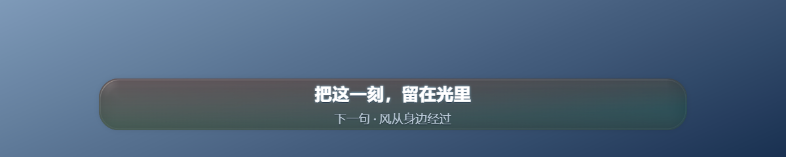

上图使用合成配色和原创演示句。旧设置默认保持原外观；在 **歌词 → 背景配色** 中选择“专辑流光”，可单独开启颜色流动。

实现与检查边界见 [改进方案](docs/DESKTOP-IMPROVEMENTS.md) 和 [公开验证概述](docs/VALIDATION.md)。构建和隔离测试不等同于完成多屏热插拔、真实播放器和长期运行验收；其他环境通过用户实际反馈继续完善。

## QQ 音乐

QQ 音乐 Windows 版可通过系统媒体会话提供歌曲、歌手、专辑、封面和播放进度，无需额外账号或插件。开启 Dock 歌词、展开桌面音乐面板或使用已授权的伴随屏音乐时，才按需采集。本机 QQ 音乐 22.22 已读到这些信息；桌面音乐卡片可使用系统封面，播放控制会定位当前显示的媒体会话。

在线歌词仍由独立开关控制。QQ 音乐来源会先核对歌曲标题、专辑、完整歌手及播放时长，再用 QQ 歌曲详情确认唯一歌曲 ID，按该 ID 获取 QQ 提供的原曲同步歌词；官方详情中的歌手显示别名可参与核对，不随意删除 Live、Remix 或艺名括号。无法确认唯一版本时明确提示，不回退到相似歌曲。桌面与伴随屏共用这份歌词、进度与缓存。当前支持带时间戳的逐行 LRC，文字动效不代表逐字演唱时间。实际检查范围见 [验证概述](docs/VALIDATION.md)。

## iPad 网页伴随屏

伴随屏主页与电脑控制页采用控制中心式模块网格：连接、专注、音乐、时钟天气、横向音量条与窗口操作。玻璃减轻 Astro 染色与控件遮罩，增强边缘折射、色散，主体保持与页面背景对齐；静态背景只合成一次，指针或触摸反馈跟随屏幕刷新回调，持续慢帧时降低分辨率并回到 30Hz。常用页可见玻璃共用一个光学场景，按滚动区域裁剪、嵌套面板去重，保留 180 万像素预算与 Safari 14 回退；目标频率不代表实机呈现帧率，本轮未重新完成实体 iPad 视觉验收。配对与控制权限不变。参见[布局参考与验证](docs/COMPANION-CONTROL-CENTER.md)。

电脑托盘 → **iPad 伴随屏** → **连接步骤**，按引导完成首次配置、iPad 证书信任及扫码配对；新安装不要求已有配置记录。**检查并连接** 会列出需要的系统变更，由你确认后请求管理员权限；同网卡换 IP 后重新连接即可。iPad 在 Safari 添加到主屏幕，随后从图标打开，使用窗口内的 **扫码配对** 扫电脑的配对二维码，首次仍由电脑批准。此后同一窗口记住设备，使用期间自动续期；无需每次输入码。Safari 与主屏幕的会话相互独立。伴随屏配置优先使用系统自带的 Windows PowerShell 5.1。详见[连接说明](docs/COMPANION.md#固定入口与换网)。

统一设置中的 **iPad 伴随屏** 可手动开启 HTTPS 局域网入口，供 iPad Safari 使用，包含 iPadOS 14.2 的实机检查。新版沿用 Sky/Astro 偏好，以[光学玻璃概念](docs/media/concepts/companion-optical-20261026.png)整理此刻、触控板、工作、应用、小组件和电脑视图；音乐、专注胶囊、小组件、控制中心与底部 Touch Bar 的可见玻璃共用场景和选定材质，文字与操作保持清晰。最终背景按用户反馈收敛为低对比蓝灰柔光远景；概念图不是运行截图。减少动画或 WebGL 不可用时回退到静态样式。

已手动开启的 iPad 伴随服务可在退出或重新开启 PrismGlass 桌面时继续运行。桌面退出后，从 Windows 托盘管理或关闭伴随屏。

网页提供时钟、天气、音乐歌词、专注、电脑状态、授权应用入口和可选共享的待办/笔记。Touch Bar 自动跟随 Chrome/Edge、VS Code 和音乐场景，也可一键固定当前场景；电脑控制中心集中提供音量滑条、专注、窗口切换、最大化/还原、虚拟桌面切换与电源入口。沉浸展示可选时钟与音乐、歌词舞台或安静时钟。应用每页 24 项，图标排队加载并在当前会话内复用，点击沿用桌面 Dock 的打开、激活与最小化逻辑。首页补充前两项未完成待办及日期提醒；音乐显示播放器提供的真实进度，可从卡片展开歌词舞台。本地小组件提供倒计时（1/3/5/15 分钟快捷选择）、秒表（最近五圈）、计算器、日期距离、世界时钟和呼吸节奏，加上按权限显示的天气、待办摘要和沉浸入口，共九种；可整理顺序与可见性，只保存非私人偏好。

在 **桌面与歌词** 中可保存电脑主题、玻璃浓度、字体大小、Dock、组件显隐和暂停策略；歌词同步电脑的字体风格、材质、颜色、换句动效与背景配色，字号适配 iPad。歌词外观需音乐与控制权限，有独立修订号，修改不改变原有显示/联网开关或时间偏移。显式开启会恢复本安装已有的隐藏采集，音乐元数据不依赖桌面歌词开关。两端冲突保留编辑，坏设置文件不会被默认值覆盖。

触控板支持单指移动、轻点左键、双击按住拖拽、双指轻点右键、双指滚动及灵敏度/自然滚动调整。右侧独立滚轮区支持上下滑动和单格滚动按钮。投屏还可选择“直接点选与拖动”或“原生触摸（双指）”，目标软件决定长按和缩放行为。**触控、键盘输入、屏幕画面、电脑系统声音和电源控制分别授权，默认关闭**。配置 FFmpeg NVIDIA 编码与 MediaMTX 后，可在同一 Safari 页面选择主屏或扩展屏、720p / 1080p 画面；右上角按钮展开或收起控制面板。点击键盘调用 iPad 原生输入法，中文选词后手动发送到电脑当前窗口，每次最多 1024 个 UTF-16 单元，暂不支持段落；常用按键单独发送。目标 30 帧，系统声音需另行授权并点击开启；Safari 要求时再点“点按播放声音”。停止投屏同时释放该设备触控，离开页面、锁屏或撤销授权后停止采集。用户已确认 iPad Air 2 / iPadOS 14.2 的点按、长按、双指缩放、中文组词删改发送及可听声音，具体范围见 [投屏配置与边界](docs/COMPANION-SCREEN.md)。

电脑端统一进入 **设置 → iPad 伴随屏**，唯一设备自动选中，权限草稿在刷新和切换设备后保留，点击 **保存设备权限** 才生效；二维码与连接配置按需展开。扫码预填配对码，提交后仍需电脑批准，无需安装 iPad App。锁定、睡眠、重启/关机分别在二次确认后等待 3、5、15 秒，倒计时内可取消；不强制关闭应用，操作不自动重放。用户已确认真实关机成功；开机 / Wake-on-LAN 尚未配置。

入口默认关闭，每次启动后需手动开启；所有共享权限默认全关，应用由电脑逐项选择。待办/笔记通过同一写入与冲突检查保存，Windows 锁屏或网页断线时隐藏私人内容并停止本页控制。首次部署需要匹配局域网地址的证书、iPad 信任设置及受限网络规则，见 [连接、操作与部署说明](docs/COMPANION.md)。源码、本机安装与真实设备结果分别说明于[验证概述](docs/VALIDATION.md)；当前 iPad 主屏幕内扫码、重开连接、真实触控/滚轮、GPU 和长期表现仍待实际使用反馈，隔离测试不会执行真实电源操作。

## 显示效果

以下均由本仓库的 **真实 WebView2 / WebGL 组件运行后采集**，不是设计概念图。采集使用独立预览环境、合成渐变底图与演示数据；不代表作者的真实账户额度或个人记录，也不是整台桌面的实机录屏。

### Dock 歌词效果

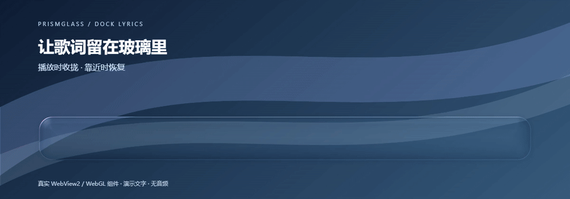

播放时玻璃条平滑收拢，换句时应用所选字效；鼠标靠近后恢复 Dock。动图依次展示 **冰蓝白字 / 浮起 → 极光流彩 / 波浪 → 玫瑰霓虹 / 弹性 → 月白楷体 / 聚焦**。

[查看高清 MP4](docs/media/dock-lyrics.mp4) · [素材与复现说明](docs/media/README.md#歌词效果素材)

> 约 13 秒循环，无音轨；文字均为演示句子。采集运行的是当前歌词与玻璃代码，只展示 WebView 图层，未包含 Rainmeter 应用图标。录制帧率不代表桌面实际帧率。

#### 在音乐面板里调整效果

<table>
  <tr><th>风格预设与实时预览</th><th>字体、字号与动效调节</th></tr>
  <tr>
    <td>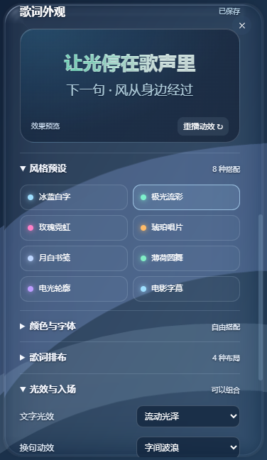</td>
    <td>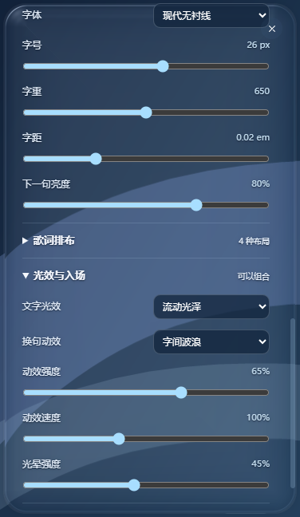</td>
  </tr>
</table>

打开 **音乐 → 歌词外观**：8 套预设、8 类字体、4 种排布、12 种换句动效和 5 种文字光效可以自由组合；颜色、强度、速度及宽度调整会自动保存。

<details>
<summary><strong>展开查看四种歌词风格的静态细节</strong></summary>

<table>
  <tr><th>冰蓝白字</th><th>极光流彩</th></tr>
  <tr>
    <td></td>
    <td></td>
  </tr>
  <tr><th>玫瑰霓虹</th><th>月白书笺</th></tr>
  <tr>
    <td></td>
    <td></td>
  </tr>
</table>

</details>

### 顶部栏 → 灵动岛 → 展开面板

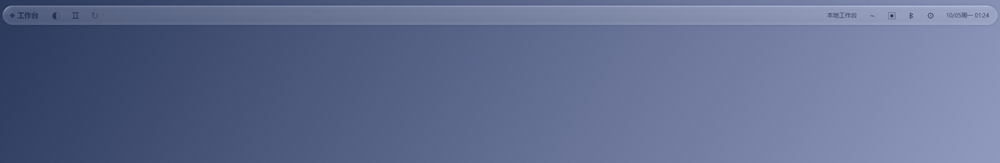

点击顶部中间区域收拢，再次点击还原；按住灵动岛向下拉，展开媒体和专注控制。上面的循环演示触发同一套真实动画状态，展示形状变化；不是鼠标手势教学录屏。

Dock 启动应用时，灵动岛短暂显示真实应用图标与“正在启动”，只有匹配的新窗口出现才显示已打开，随后恢复原内容。应用请求注意时可点击提示或按 Enter 回到该窗口；充电变化、歌曲切换及专注结束也有短暂反馈。保留手动展开状态和减少动画，连续相同注意请求不会重复弹出；系统消息正文尚未接入。

[查看 MP4 演示](docs/media/top-island.mp4) · [查看展开面板原图](docs/media/top-expanded.png)

### Sky / Astro：同一套组件，两种氛围

<table>
  <tr><th>Sky · 轻透玻璃</th><th>Astro · 深色星空</th></tr>
  <tr>
    <td>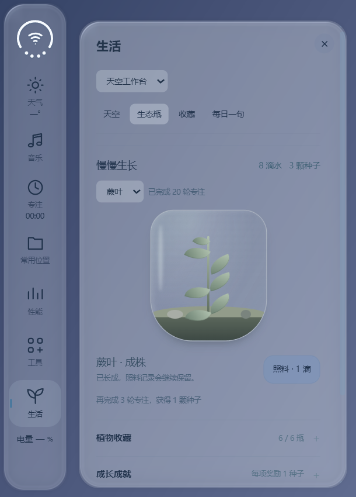</td>
    <td>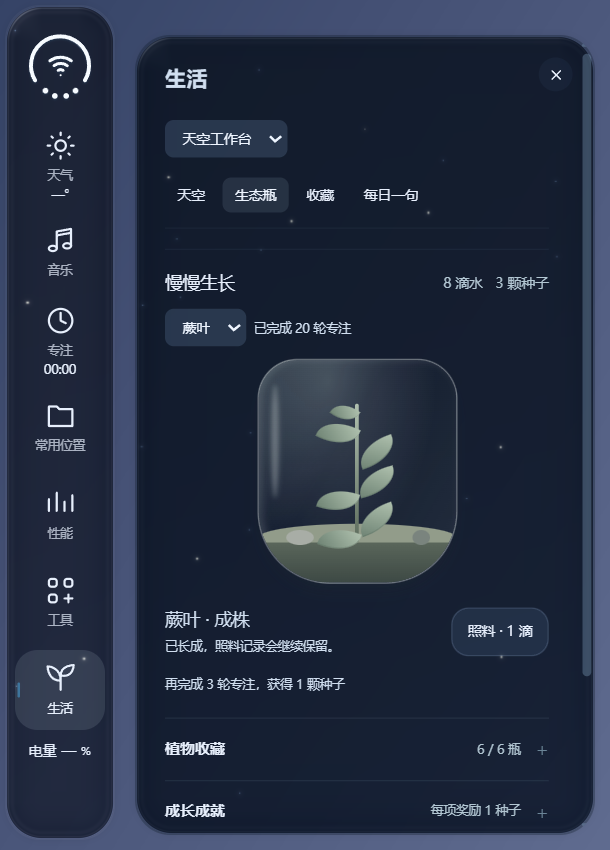</td>
  </tr>
</table>

两种主题保留同样的布局与操作。生态瓶会随着专注与照料成长，图中植物、滴水和种子数量均为演示存档。

### 右侧工具区：额度看板与随手记

<table>
  <tr><th>额度圆环与详情</th><th>随手记 · Astro</th></tr>
  <tr>
    <td>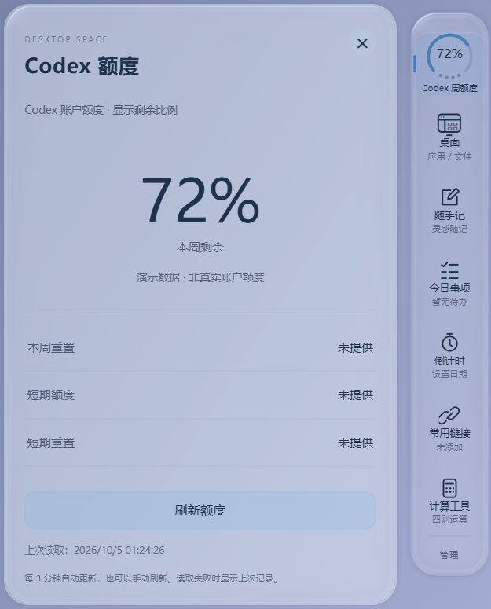</td>
    <td>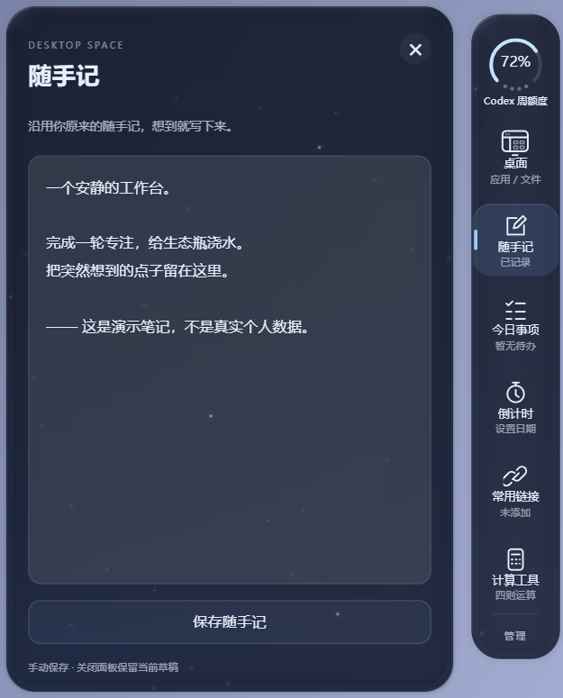</td>
  </tr>
</table>

额度默认每三分钟更新；不可用时显示未获取。右侧同时提供桌面快捷方式、今日事项、倒计时、常用链接和计算工具，悬停查看、点击操作。

<details>
<summary><strong>更多截图：植物收藏与两侧组件管理</strong></summary>

<table>
  <tr><th>六种植物收藏</th><th>统一管理两侧入口</th></tr>
  <tr>
    <td>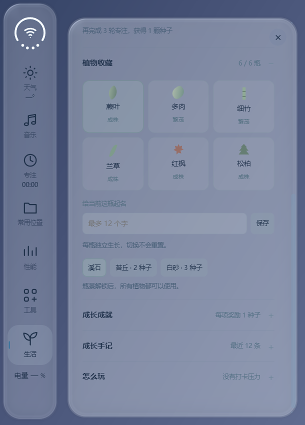</td>
    <td>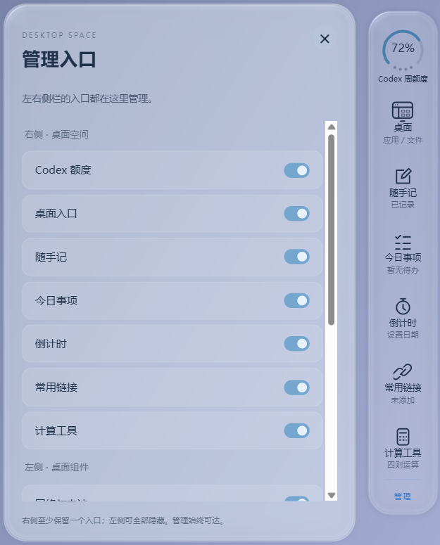</td>
  </tr>
</table>

</details>

素材来源、演示条件与复现方法见 [效果素材说明](docs/media/README.md)。

## 功能

- **液态顶部栏**：点击中间向内聚拢，再次点击展开；按住下拉打开内容；轮廓绘制与原生裁切共用形状数据。
- **双主题**：Sky 与 Astro，保留玻璃折射、跟手渐变、形变和动态氛围。
- **左侧栏**：Wi-Fi / 电量、天气、音乐、专注、常用位置、性能、工具和生活。
- **右侧栏**：Codex 额度圆环、桌面快捷方式、随手记、今日事项、倒计时、常用链接、计算工具；支持悬停展开和统一管理。
- **生态瓶**：六种植物、独立成长、浇水、装饰、收藏、成就与日志。
- **应用 Dock**：从本机提取图标，固定应用与运行窗口，遮挡隐藏、底部边缘唤出和窗口预览。
- **Dock 歌词**：播放时玻璃底板平滑收缩，超长句缓慢滚动。音乐面板内提供 8 套预设、8 类系统字体、4 种排布、12 种换句动效、5 种文字光效，以及颜色、字号、字重、字距、亮度、光晕、动效强度/速度和宽度调整。默认白字；设置实时预览并自动保存。鼠标靠近、暂停、无歌词或媒体信息过期时恢复图标。
- **系统托盘入口**：顶部右侧箭头打开 Windows 隐藏图标托盘；关闭后恢复美化桌面，不改变任务栏的持久设置。
- **透光玻璃**：共享渲染器增加圆弧边缘厚度、RGB 折射与 Fresnel 反射，降低表面白色叠层；文字统一使用白色与轻微阴影。Dock 保留原有强度的跟手折射、彩色流光、形变与图标弹跳。
- **材质统一（源码新增）**：应用操作、重命名、分类与确认弹窗，以及原生 Dock 窗口预览、Dock 和本程序的托盘菜单共用玻璃渲染器，跟随 Sky／Astro 与玻璃浓度。原生菜单继续保留键盘操作，窗口预览继续使用 DWM 缩略图。
- **实时窗口背景（实验）**：在 **设置 → 外观** 单独开启，默认关闭。开启后经用户授权使用 Windows Graphics Capture 和共享内存纹理进行实时折射，不依赖后方应用的 `PrintWindow` 黑帧；关闭、暂停、锁屏或捕获不可用时恢复壁纸。不保存或上传背景帧。混合 DPI 多屏、所有第三方应用与长期功耗仍需按目标设备验收。
- **按需开启**：默认开机不运行美化或恢复脚本，可选择开机自启；美化就绪后临时隐藏原生图标和任务栏，退出时恢复。

任何仍可见的最大化或全屏应用覆盖主屏时，顶部和左右栏隐藏；即使切到另一个普通窗口也保持隐藏。覆盖窗口最小化、关闭或还原为不覆盖主屏的普通窗口后恢复；已隐藏和其他虚拟桌面的窗口不参与判断。底部 Dock 保留独立的边缘唤出规则。当前以主显示器为目标。

## 操作速查

| 想做什么 | 操作 |
|---|---|
| 收起顶部栏 | 点击顶部中间留白，聚拢为灵动岛 |
| 展开顶部内容 | 按住灵动岛向下拖动 |
| 恢复完整顶部栏 | 再次点击灵动岛 |
| 打开系统托盘 | 点击顶部右侧“打开系统托盘”箭头 |
| 看侧栏内容 | 鼠标短暂停留，避免快速划过误触发 |
| 调整两侧入口 | 右侧底部进入“管理” |
| 培养生态瓶 | 左侧“生活 → 生态瓶”，完成专注获得照料资源 |
| 唤出被遮挡的 Dock | 在屏幕底边短暂停留 |
| 开启 Dock 歌词 | 左侧“音乐”中开启“让歌词留在 Dock”；需要新歌词时另开启“在线匹配” |
| 调整歌词外观 | 同一面板向下滚动到“歌词外观”，选择预设或展开颜色、字体、排布、光效设置 |
| 微调歌词时间 | 同一面板选择“提前 / 延后”，每次 0.2 秒；点中间重置 |
| 回到普通桌面 | 使用“退出 PrismGlass”快捷方式 |

## 依赖

- Windows 10/11 x64，.NET Framework 4.8。
- Windows 自带 PowerShell 5.1、[Rainmeter](https://www.rainmeter.net/) 和 [WebView2 Evergreen Runtime](https://developer.microsoft.com/microsoft-edge/webview2/)。已有 PowerShell 7 安装仍可复用；开发构建与测试脚本使用 PowerShell 7。
- 开发构建需要 Node.js，用于 JavaScript 语法检查；编译使用 Windows .NET Framework 自带的 C# 编译器。
- 可选：官方 Codex CLI（自行安装并登录），用于读取本人额度。读取失败会显示未获取，不会伪造数字；默认每三分钟刷新。
- 可选：Python 3 与网易云音乐桥接，安装时显式启用。
- 可选 Dock 歌词：优先读取 Windows SMTC 歌曲信息和有效进度；另适配网易云 Windows **3.1.41.205529** 的本地播放时钟。SMTC 读取器使用系统自带 Windows PowerShell 5.1 的 .NET Framework WinRT 投影（兼容性需要）；安装、卸载、桌面运行和伴随屏配置均兼容 5.1；仅开发构建与测试入口使用 PowerShell 7。歌词功能本身不依赖 Python。

## 构建与安装

在 PowerShell 7 中：

```powershell
git clone https://github.com/liburce0412-alt/prismglass-desktop.git
cd prismglass-desktop
./scripts/Test.ps1
./scripts/Build.ps1
./dist/PrismGlass/Install.ps1 -Latitude 31.23 -Longitude 121.47
```

安装 Inno Setup 6 后，可生成与 Releases 同格式的安装器：

本地构建的完整标识可在托盘“关于 PrismGlass”、安装目录的 `build-info.json` 和运行时的 `LiquidDesktop/readiness.json` 中核对。安装器文件属性的产品版本也显示同一标识，便于区分使用相同发布版本号的本地改动。

```powershell
./scripts/Package.ps1 -CompilerPath 'C:\Program Files (x86)\Inno Setup 6\ISCC.exe' -Version (Get-Content VERSION -Raw).Trim()
```

发行构建应使用干净签出与空输出目录；`-CacheRoot` 可复用开发依赖，`-OutputRoot` 可指定独立构建目录，不能指向正在使用的安装。`Package.ps1` 会拒绝个人配置、配对记录和证书文件。源码版本、程序版本与安装器版本来自 `VERSION`。

以上是开发者构建与脚本安装方式。普通用户可使用 Releases 中的安装器。构建使用固定版本的 WebView2 SDK、QRCoder 与 NAudio 2.4.0（Core / Wasapi，.NET Standard 2.0）。音频依赖优先复用构建缓存，缺少时从 NuGet 下载并核对固定包摘要。脚本默认安装到 `%LOCALAPPDATA%\PrismGlass`，根据 Rainmeter 配置识别皮肤目录。升级保护未归属的皮肤和手工安装目录。

Rainmeter 在非标准目录时传入 `-RainmeterPath '你的路径\Rainmeter.exe'`。天气坐标是参数，默认是伦敦示例位置；请按需要设置。选择 `-EnableMusicBridge` 才会启用网易云音乐信息读取。要仅准备文件、不改桌面和启动项，传 `-PrepareOnly -Destination '一个新的空目录'`。

图形安装后使用桌面的 **PrismGlass** 启动，退出在托盘或开始菜单中操作。图形安装向导默认在点击“完成”后开启美化，可取消该选项；开发者脚本和静默安装不自动启动。安装不创建登录启动项或计划任务，不修改系统壁纸；开机自启由用户在“启动与退出”中选择，默认关闭。直接打开程序也执行完整启动流程；运行期间不把任务栏自动隐藏或桌面图标隐藏保存为下次登录的设置。

安装时记录 Rainmeter 实际 SkinPath，运行组件共用该路径。不要同时运行另一套 PrismGlass 实例。

Rainmeter 控制命令直接发送给已配置的运行实例，并设置响应超时；无响应时暂停重试，不再反复创建命令进程。启动失败会报告原因并尝试恢复普通桌面；退出或卸载会等待所属皮肤实际关闭，失败时保留皮肤文件。

## 配置与退出

### Dock 歌词

显示和在线匹配默认均关闭，在左侧“音乐”中独立开启。开启显示后，通过 Windows 媒体会话读取当前播放的标题、歌手、专辑、时长、位置与播放状态。优先当前会话；当前暂停时选择仍在播放的会话。播放器未提供有效时间轴时保留正常 Dock，不估算歌词时间。

网易云 3.1.41.205529 未提供 SMTC 时，使用本机窗口标题、播放队列和经过版本/模块大小校验的只读播放时钟。只读取进度与时长两个数值；未验证的版本不使用该适配，仍可通过 SMTC 接入。升级网易云后若歌词停止，请先检查其媒体会话是否提供进度。

QQ 音乐按上方的歌曲版本确认流程获取原曲歌词；网易云来源先尝试本地队列中的精确歌曲 ID，其他来源或网易云未命中时通过 LRCLIB 按歌曲元数据精确匹配。不匹配纯文本歌词，不根据标题随意选相似歌曲。歌词在本地保存有大小限制的最近 32 首缓存；关闭在线匹配后仍可使用已缓存的同步歌词。QQ 的已验证缓存与旧匹配缓存区分，旧结果不会绕过版本确认。切歌取消旧请求，网络失败有限次重试；无歌词时图标保持可用。

鼠标进入 Dock 附近或窗口预览时恢复图标，离开并稳定约 0.7 秒后再显示歌词。暂停、遮挡、全屏和过期媒体状态会恢复图标。已有同步歌词的前奏、空白间奏默认保留歌词栏，显示曲名及前奏/间奏标识；可关闭“前奏、间奏保持歌词栏”。短暂的文件读取冲突沿用尚未过期的采样，网易云连续约 1.2 秒无进度才判断暂停，避免空闲时反复切换。时间微调范围 ±5 秒；暂停动效或 Windows 关闭界面动画时直接切换文本。退出主进程后媒体读取器停止，Rainmeter 在歌词心跳到期后恢复图标。

歌词通过 Unicode 消息直接交给现有 WebView2 玻璃层显示，收缩沿用顶部栏可中途反向的弹簧动画，也可在外观设置中选择固定宽度。字效参考 Folia / Mineradio 的白色字芯、柔和辉光、可调字体/配色和前后句层次，自行实现。字间波浪、涟漪等是换句装饰，只有逐行 LRC 时不会伪造逐字演唱时间。字体使用本机已安装的字体，缺失时自动回退；安装器将 Rainmeter 的 `.ini`、`.inc`、`.lua` 写为 UTF-16，避免刷新频率丢失和中文乱码。

设置位于 `LiquidDesktop/lyrics-settings.json`，缓存位于 `music-data/lyrics-cache.json`。歌词与封面服务属于第三方，可能缺少歌曲、限流或不可用。实际支持取决于播放器的 SMTC 实现，不保证所有网易云、Apple Music 或其他播放器版本都提供同步进度。

### 桌面与组件

- 在右侧“管理”中控制两侧组件；笔记、事项、生态瓶进度保存在安装目录中。
- 固定应用配置在 `LiquidDesktop/pins.json`，安装时生成“文件、记事本”两个通用入口；应用路径和图标从用户自己的电脑获取。
- 顶部刷新功能采样本机当前静态壁纸作为玻璃底图，显示更新进度、完成或失败提示；它不会更换 Windows 壁纸。同一张壁纸重复刷新，外观可能没有变化。采样仅在本地使用，不上传壁纸。
- 若组件异常，运行 `pwsh -File '<安装目录>\DesktopMode.ps1' -Mode Recovery` 恢复原生桌面。
- 修复旧版遗留的空白桌面时，会同步清除 Explorer 当前视图与保存布局中的“隐藏图标”标记，保留图标位置和大小；不靠开机恢复脚本。手动开启美化期间只临时隐藏当前图标窗口。
- 旧版安装可能在启动文件夹留下 `PrismGlass - Restore ordinary desktop.lnk` 或“恢复原生桌面.lnk”；更新到本版后可移除指向本套安装的该快捷方式。当前安装器不再创建它。
- 使用图形安装器安装的版本，先退出美化，再从 Windows“已安装的应用”卸载。卸载器移除所属程序、Rainmeter 皮肤代码和快捷方式，默认保留个人数据、伴随屏配置记录与共享依赖；需要保留的内容可先备份。旧脚本安装不在该卸载器的管理范围内。

## 隐私与依赖边界

此仓库包含白名单源码、皮肤模板、测试、文档及使用独立演示数据采集的效果素材。**不包含**作者的账号、Cookie、WebView2 用户目录、额度缓存、个人应用列表、真实笔记、私人桌面截图、游戏图标、音乐封面或原始壁纸。

运行时的本地数据和网络请求见 [隐私说明](docs/PRIVACY.md)。第三方依赖及参考见 [第三方声明](THIRD-PARTY-NOTICES.md)。MIT 许可证适用于本仓库自有代码；第三方程序、品牌与素材不由此重新授权。

## 验证范围

Dock 歌词与玻璃增强的本地检查、复现命令和仍需实机验收的边界见 [验证记录](docs/DOCK-LYRICS-VALIDATION.md)。

自动检查覆盖 Dock 隐藏／唤出策略、普通窗口与各栏的重叠、最大化／全屏识别、跨屏排除、鼠标设置保存与旧大小兼容、JavaScript 与 PowerShell 语法；CI 在 Windows 上构建。顶部与两侧按各自实际占用区域判断遮挡：普通窗口盖住哪一栏就隐藏哪一栏，移开后恢复；全屏／最大化覆盖仍隐藏全部组件，透明悬浮层不参与判断。鼠标设置另通过独立 WebView 预览交互和原生拖尾绘制检查，这些交互检查不在 CI 中自动执行。通过编译不代表已验证所有显卡、DPI、显示器布局或真实重启。当前公开版仍需更多不同机器的实际测试。

## 常见问题

**为什么我的玻璃底色与截图不同？** 玻璃使用本机壁纸采样，主题、壁纸、DPI 和显示器都会影响观感。仓库素材使用默认渐变底图，不包含作者原始壁纸。

**没有 Codex 账号可以使用吗？** 可以，桌面主体不依赖 Codex。额度组件需要自行安装并登录官方 CLI，其他组件可独立使用。

**开机会自动开启美化吗？** 默认不会。在 **设置 → 启动与退出** 开启“开机自启”后，下次登录当前 Windows 账户时自动开启美化；可随时关闭。

**截图就是安装后的完整桌面吗？** 不是。截图是公开代码的真实组件预览，用演示数据展示细节；当前没有把作者的私人桌面整体录屏公开。

## 目录

```text
src/LiquidDesktop/  原生窗口、数据和 WebGL/HTML 界面
rainmeter/          Rainmeter 配置模板和 Lua 数据桥
scripts/           构建、安装、恢复与检查
tests/             行为回归测试
licenses/          第三方许可文本
```

欢迎通过 Issues 提交复现步骤、Windows 版本、DPI、显示器布局及经过脱敏的画面。

### 自定义指针与拖尾
右侧栏 → 管理 → **鼠标与拖尾**，选择后即时应用并保存：

- **指针**：圆润黑、圆润白、macOS、Windows 原样；美化指针支持 75%、100%、125%、150%、200% 大小。Windows 原样沿用系统指针和大小，并保留另行保存的美化大小。
- **拖尾**：可独立开启或关闭，选择微光粒子、星光或流线；支持四个预设颜色和自定义 `#RRGGBB` 色值。关闭后仍记住样式和颜色。
- **恢复**：退出美化时重新加载原来的 Windows 指针样式和大小；下次手动开启再应用保存的美化选择，不改写 Windows 指针设置，也不需要登录恢复任务。

拖尾穿透点击、不抢焦点，与桌面共用进程；停留后自然消散，暂停动效或退出美化时关闭。文本、链接、缩放和等待指针保留各自用途。两款圆润箭头由 `tools/CreatePrismCursor.cs` 原创绘制，其余指针来自 [antiden/macOS-cursors-for-Windows](https://github.com/antiden/macOS-cursors-for-Windows)，遵循 MIT 许可。

### Pegline 截图晾绳（可选）
可随美化开启／退出，不增加开机启动。快捷键 Ctrl+Alt+T，截图接管由用户选择。照片可沿绳左右拖动，绳形随照片大小和位置变化，松手后自然回摆；向下拉离绳子仍可拖入应用或文件夹。点 × 将原图移到回收站并移除卡片；右键“仅取下（保留文件）”可只移除卡片。[安装、操作及补丁](integrations/Pegline/README.md)。

### 体验打磨与源码实验

可选 **设置 → 文字提取** 使用 Intel NPU 在本机识别当前屏幕，结果查看后手动复制；不保存截图、不上传画面。源码工作区另提供仅采集 Codex 窗口的 NPU 超分快照预览，可对比原图、普通放大和 NPU 结果；该实验未包含在 1.1.1 安装包中。需单独准备运行环境，步骤与实测见 [NPU 工具与超分实验](docs/NPU-TOOLS.md)。当前超分模型延迟不适合 30 帧投屏，未接入实时画面。

工作区将应用刷新与设置保存反馈分开，保留保存冲突和重试入口；随手记只依据对应内容的确认显示已保存。左栏点击留驻后不会因宿主失焦自动收起，关闭返回原入口，左右栏的 Esc 尊重输入法组词。

伴随屏文字发送会显示等待、发送中和完成状态；后台保活占用时等待同一有效会话后发送一次。显示方式可选择保持比例或拉伸铺满（会变形），不更改电脑屏幕分辨率。工具内 Esc 收起工具，不停止控制。

新增可选直接点选与拖动及外接键盘直输；点选和按住移动绑定有效投屏与控制租约，滚动使用右侧滚动条或触控板。画面布局变化、取消手势和失联会释放按住状态，留边显示成组快捷操作。短暂 ICE 断连最多等待 6 秒；网络保活失败仅重试一次，失效租约不重试。重连保留来源意图，电脑端重启后须重新选择屏幕。文字上限提升至 1024 UTF-16 单元，同一授权会话恢复后可核对内存草稿，不自动重发。

系统声音现可单独授权并点按开启，包含其他应用与通知；旧配对默认无声音权限，不使用麦克风。音频失败或关闭时保留视频，灵动岛显示声音共享状态；停止投屏、撤权、锁定或心跳超时会释放采集。本机已实测系统回环、Opus 编码、WebRTC 解码与独立停止。

设备管理标记当前在线的配对记录，便于区分同名设备。本轮真实 iPad Safari 已播放视频，完成 500 字中文加标点与 emoji 的表单传输，用户点按后确认听到系统声音，并确认中文组词、删改和手动发送正常；长时间音画同步另行验收。

旧 Rainmeter 顶栏及 Dock 的旧平面背景回退层已移除；新版玻璃 Dock 的图标与点击层保留，退出时一并停用，不再遗留旧桌面外观。

独立副屏开启时读取页面方向，仅在驱动枚举和 Windows 配置校验均支持时旋转受管理的虚拟屏；失败回退到驱动首选方向，实体屏配置保留。当前电脑的竖屏校验被驱动拒绝，使用 1440×1080；旋转 iPad 不会自动重配运行中的副屏。

上述桌面和伴随屏功能已纳入正式版；仅 Codex 窗口 NPU 超分仍是源码实验，未包含在安装包中。500 字中文和 emoji 已在 Windows 编辑框与 Chromium 文本区实测；直接 Unicode 换行在浏览器中被吞掉，因此保留单行与独立电脑回车。软键盘保留手动发送，避免把本地删改误映射到远端光标；音画同步、输出设备切换和长期稳定性待实机验证。

原生触摸模式已接入 iPad 事件与 Windows 双触点通道，保留鼠标直接点选及触控板。支持有序按下、完整帧移动、独立抬起和取消，长按/缩放取决于目标应用；异常与断线自动释放。Windows 先取消触点后，停止控制不再卡在等待释放。29 项 Windows 原生触摸检查通过，用户确认真实 iPad 点按、长按、双指缩放有效；专用浏览器页记录到双触点、长按菜单及缩放变化。179 项桌面和 178 项伴随页隔离 UI 检查通过，桌面检查增加了浅色、深色、复杂壁纸与最小窗口大字号组合。iPad 投屏顶部为系统状态栏保留至少 24 CSS 像素，画面、触控和键盘布局同步避让。左右栏支持中途反向和应用内减少动画。GPU 子进程退出与短暂 WebGL 上下文丢失会尝试就地恢复画面，保留页面和草稿；11 项隔离原生窗口恢复检查通过。电脑端音视频连续解码两分钟及声音重连通过；这些不代替 iPad 音画同步或长期稳定性验收。

Dock 横向经过图标时，相邻图标形成平滑移动的放大波峰，点击区同步跟随；离开后回落，悬停切换不重复弹跳。应用提醒仍可弹跳；拖拽和减少动画保持稳定布局。紧密排列时限制放大量。

Dock 只在当前悬停图标上方显示应用名称小胶囊；相邻放大项不显示名称。离开、拖拽、打开工作区或窗口预览时隐藏，长名称省略显示，原生默认工具提示关闭。
