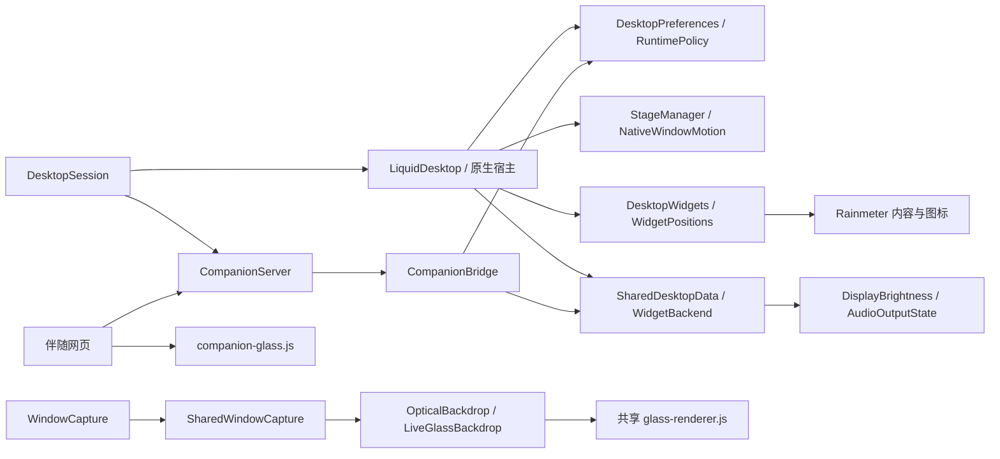

# 模块边界与扩展方式

本说明对应 PrismGlass Desktop 2.0.0。`DesktopSession` 在同一个 Windows 用户进程中持有伴随服务，并独立控制桌面渲染器的启停。

| 责任 | 实际入口与依赖 | 添加功能的位置 |
| --- | --- | --- |
| 桌面协调 | `LiquidDesktop` 创建显示器宿主，读取 `RuntimePolicy` 和偏好，协调窗口可见性、输入和布局 | 只保留宿主生命周期与路由；设备 I/O 不放入 Tick |
| 启停 | `PrismGlass.exe` 通过 `StartupTransition` 显示遮罩并等待真实就绪。`DesktopSession` 管理桌面渲染器、共享服务和独立伴随窗口 | 普通退出释放桌面并保留已开启的伴随服务。维护退出同时关闭两者 |
| 保存与显示器 | `DesktopPreferences` 验证设置，`DesktopSettingsFiles` 原子写入；`MonitorCatalog` 提供显示器标识 | 设置需同时接默认值、校验、桌面控件及必要的伴随字段 |
| 组件位置 | `ComponentPosition` 管理原生栏；`WidgetPositions` 管理 Rainmeter 卡片 | 只把明确拖动写入保存布局；断屏、缩放和避让采用临时位置 |
| 台前调度 | `StageManager` 管窗口分组、尺寸、恢复日志；`StageStrip` 管输入与 WPF 卡片 | 新布局进入现有恢复/切换链；先计算全部目标，再改变实际成员，保留恢复日志 |
| 窗口动效 | `NativeWindowMotion` / WPF 合成事件；`DockBackend` 验证和调用真实窗口 | 不用动画帧计数代替实际 HWND 状态；取消/反向切换需覆盖 |
| 玻璃 | `WindowCapture` → `SharedWindowCapture` → `OpticalBackdrop` / `LiveGlassBackdrop` → WebView `glass-renderer.js` | 捕获按源共享；像素工作留在受控后台与 GPU；跨宿主数据使用现有有界队列 |
| 小组件 | `DesktopWidgets` 管 Rainmeter HWND；`LiquidGlass.lua` 管玻璃宿主；`WidgetArt.lua` 管六种新内容 | 沿用启停、布局锁、主题、动效策略和 `DockLabel` 胶囊；不要另开一个提示渲染器 |
| 设备与数据 | `SharedDesktopData` 共享缓存，`WidgetBackend` 路由设备动作，`DisplayBrightness` 处理后台亮度探测/写入 | CPU 慢 I/O 不能进入 UI 拖动；连续输入只保留最新待写值，读回才确认状态 |
| 伴随授权与控制 | `CompanionServer` 守 HTTP 会话、CSRF、速率；`CompanionBridge` 守功能许可、锁屏与输入范围 | 两层边界分别维护，不用前端隐藏代替后端验证；只有指定连续动作使用独立速率预算 |
| 伴随展示 | `companion.js` 协调页面；`companion-settings.js`、`companion-widgets.js`、`companion-glass.js` 各自负责设置、内容、材质 | 共用电脑数据与设置契约，保留触摸和 Safari 差异；电脑端结果不能代替 iPad 验收 |
| 图标 | `functional-icons.js` 为宿主已有的 SVG 图标添加悬停、按压及聚焦反馈 | 保留原图标和可访问名称，沿用共享动效策略 |

## 本轮审计后已处理的问题

- 卡片可见位置此前同时承担“用户原布局”与“断屏临时校正”。新增小型 `WidgetPositions`，保存显示器归属和归一化锚点，临时避让不写回；损坏数据报错并保留。
- 原生栏原先只在工作区矩形变化时重载锚点，同样矩形换屏容易沿用错误位置。显示器变化事件现在使身份缓存失效；避免每帧枚举显示设备。
- 窗口分组原先复用原矩形，合并后重叠。布局计算接回 `StageManager` 的原恢复与过渡链，遵循工作区、可见栏位和窗口最小尺寸。
- 玻璃提示复用 `DockLabel` 的唯一消息通道，卡片提示检查放在预览生命周期，独立于 Dock 自动隐藏判断；屏幕顶部自动改放卡片下方。
- 连续调节与亮度硬件调用从界面动作中解耦，桌面与伴随复用连续输入模块和同一后端。权限判断仍留在原边界。
- 打包拒绝携带 `component-positions.json`、`widget-positions.json` 与 `stage-recovery.json`，避免把用户布局/窗口恢复数据混入分发包。
- 主屏鼠标输入改由唯一 RawInput 接收者提供轻量快速路径，保留普通计时器兜底。每个 WebView 只保留一个在途指针包和一个最新位置；网页轻量确认收到坐标，过期后重发最新位置，绘制仍由动画帧调度。

## 保留的结构与限制

`LiquidDesktop.cs` 与 `companion.js` 仍是较大的协调入口；本轮没有为了拆文件迁移成熟行为。新增行为先落到已有责任模块，确有独立状态或慢 I/O 时才拆小模块。

小组件名称仍分布于桌面偏好目录、Rainmeter 目录、启停脚本和伴随目录。它们包含不同平台语义，暂不引入运行时插件注册系统。增加组件必须一起检查这些入口；`TestDesktopWidgets` / `TestWidgetArt` / `TestCompanionWidgets` 覆盖目录、行为与平台差异。

原生构建会收集源码目录中的 C# 文件；独立测试脚本显式列编译文件和引用，因此新设备模块必须同时接入受影响测试。功能验证优先运行本轮涉及的脚本，不需要每次重跑无关网络、安装或长时测试。

120 FPS 仍需要实际呈现证据。WinForms `Timer(8)`、Rainmeter 更新间隔、WebView 提交和 WPF 合成是不同节奏；提高常量不等于提高呈现率。当前性能测量与未完成项记录在本轮结果文档，不能用静态检查代替硬件校准。

## 后续最小扩展检查

1. 找到本表责任模块和现有调用者，复用现有数据/权限/恢复路径。
2. 更新受影响的默认值、校验、设置入口、伴随契约、安装资产或第三方许可。
3. 给新状态或分支补一个短的行为检查；运行时改变观察真实窗口/实际读回。
4. 报告源码、构建、安装、真实设备和公开发布状态，分别记录。
